# Use Case, User Story & Business Flow Diagrams

## Home Services Marketplace

| Attribute | Value |
|---|---|
| Document ID | D02-A01 |
| Version | v0.1 |
| Status | Draft for review |
| Date | 03 Nov 2026 |
| Source baseline | HLR v0.2 and SRS v0.3 |
| Release strategy | R1 Core Marketplace first; R2 AI Enhancement after R1 phase gate |
| Purpose | Clarify actors, use cases, user journeys, user stories, acceptance criteria and traceability |

> **Governing principle:** AI depends on Core Marketplace. Core Marketplace must not depend on AI.

---

## 1. How to Read This Document

- **R1** contains the complete manual marketplace workflow.
- **R2** adds optional AI-assisted request understanding and provider recommendation.
- Mermaid diagrams can be rendered in GitHub, GitLab, Azure DevOps Wiki, Mermaid Live Editor, Obsidian or compatible Markdown viewers.
- `MUST` stories are required for the applicable release baseline. `SHOULD` stories are desirable but may be deferred with approval.

---

## 2. Actors and System Context

### 2.1 Actor Context Diagram

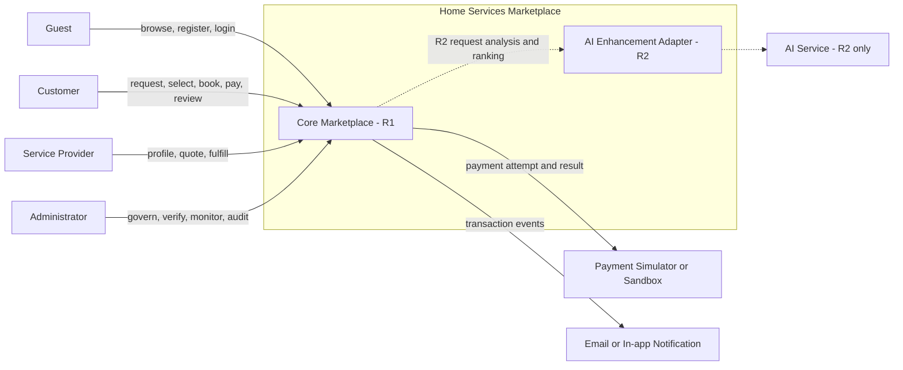

### 2.2 Actor Responsibility Matrix

| Actor | Core Responsibilities | Data Boundary |
|---|---|---|
| Guest | Browse catalogue/public provider profiles; register; login | Public data only |
| Customer | Manage profile/address; create request; discover/select provider; decide quotation; manage booking/payment/review | Own transactions only |
| Provider | Maintain profile/services/areas/availability; submit verification; quote; fulfill jobs | Own provider data and selected/confirmed jobs only |
| Administrator | User/catalogue governance; provider verification; transaction monitoring; moderation; audit | Authorized administrative views |
| Payment Adapter | Return demonstration payment outcome | Booking reference, amount and correlation ID only |
| AI Service, R2 | Suggest structured request fields; rank already eligible providers | Whitelisted fields, no secrets or unnecessary personal data |

---

## 3. Use Case Landscape

### 3.1 Complete Use Case Diagram

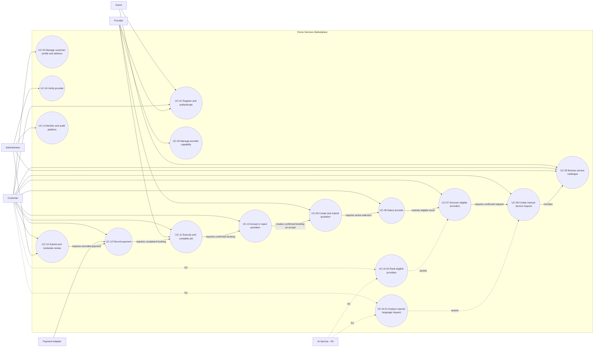

### 3.2 R1 Core Marketplace Boundary

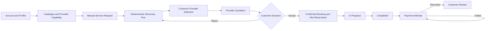

### 3.3 R2 AI Enhancement Boundary

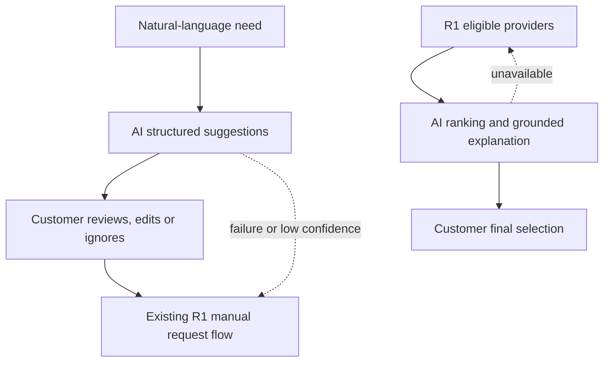

---

## 4. Core Lifecycle Diagrams

### 4.1 Service Request State Diagram

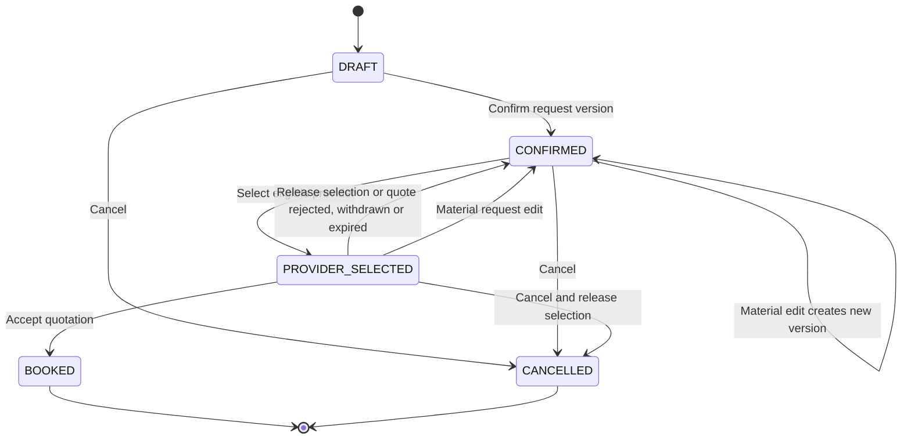

### 4.2 Provider Selection and Quotation State Diagram

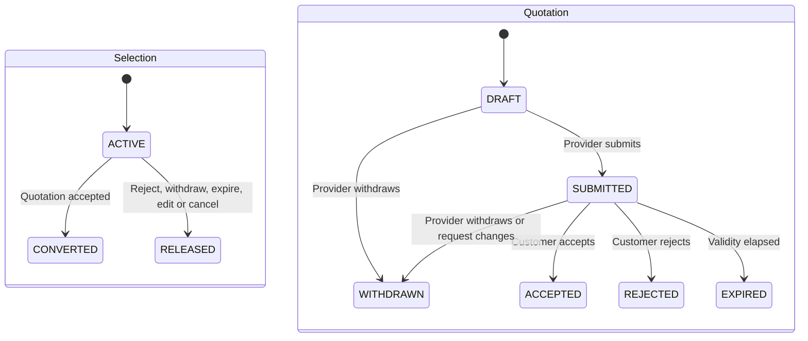

### 4.3 Booking, Reservation, Payment and Review State Diagram

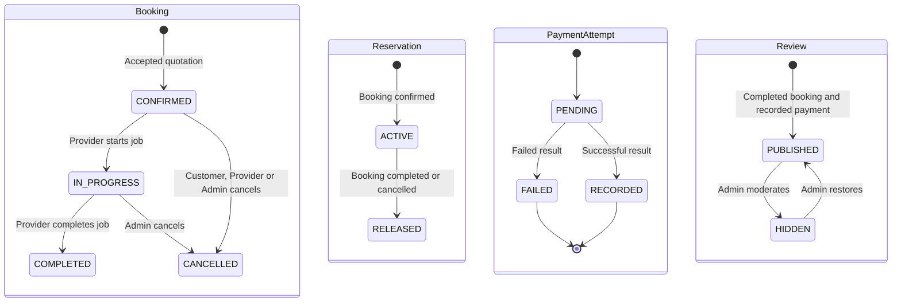

---

## 5. Detailed Use Case Diagrams

### 5.1 UC-01: Create Service Request Manually

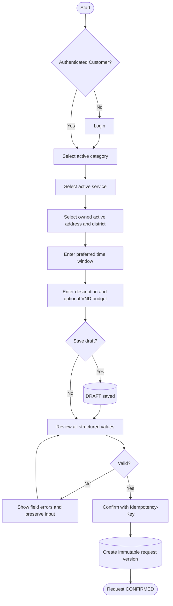

**Primary requirements:** FR-SRQ-01 to FR-SRQ-06, FR-CUS-03, BR-SYS-01, BR-SYS-10, BR-SYS-14.

### 5.2 UC-02: Discover and Select Provider

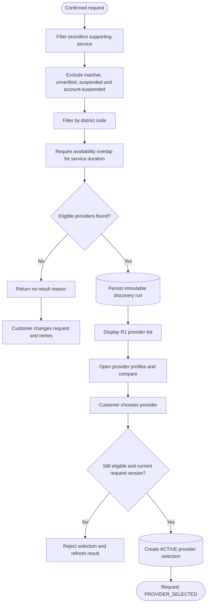

**Primary requirements:** FR-DIS-01 to FR-DIS-08.

### 5.3 UC-03: Provider Creates and Submits Quotation

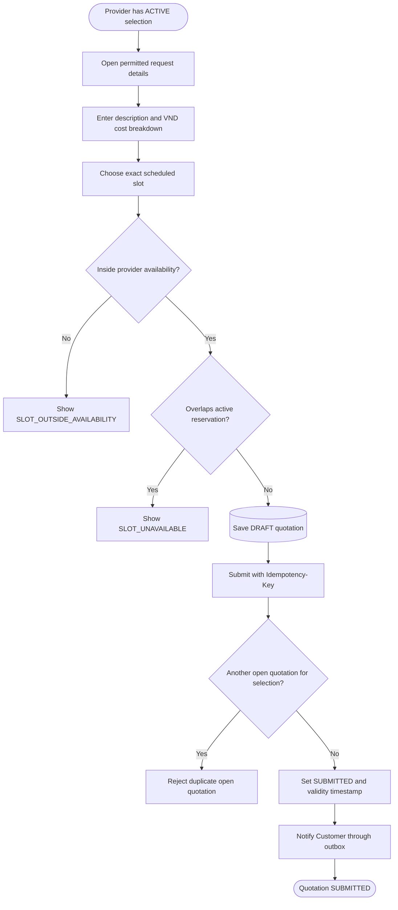

**Primary requirements:** FR-QUO-01 to FR-QUO-05.

### 5.4 UC-04: Customer Accepts Quotation and System Prevents Double Booking

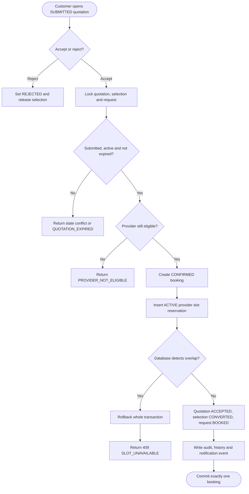

**Primary requirements:** FR-QUO-03 to FR-QUO-05, FR-BKG-01, FR-BKG-05, NFR-04.

### 5.5 UC-05: Execute and Complete Job

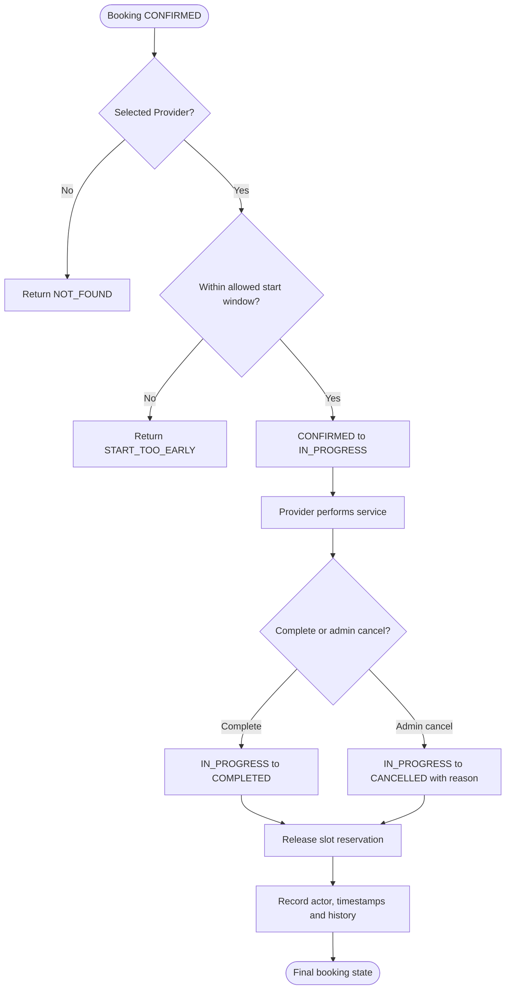

**Primary requirements:** FR-BKG-01 to FR-BKG-06.

### 5.6 UC-06: Payment and Review

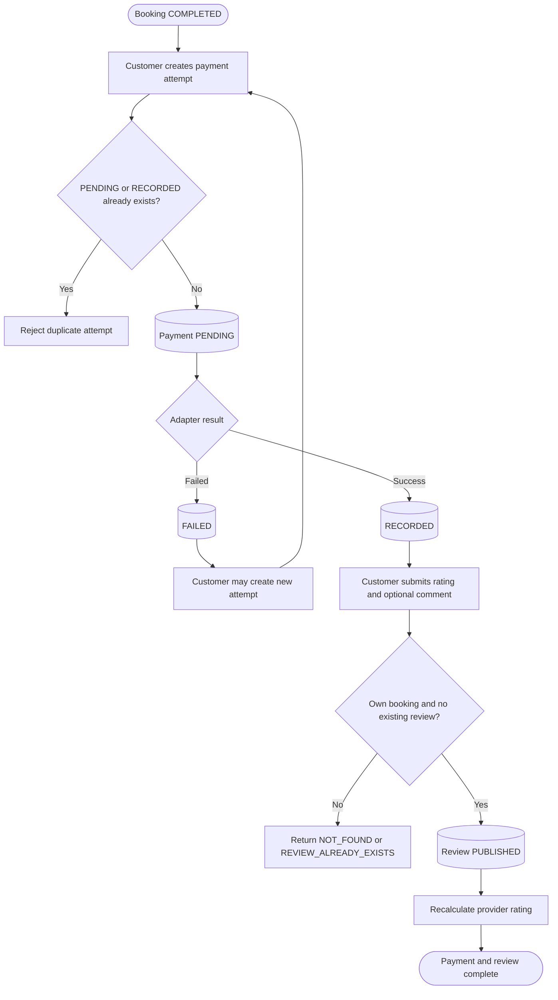

**Primary requirements:** FR-PAY-01 to FR-PAY-03, FR-REV-01 to FR-REV-03.

### 5.7 UC-AI-01: AI-Assisted Request, R2

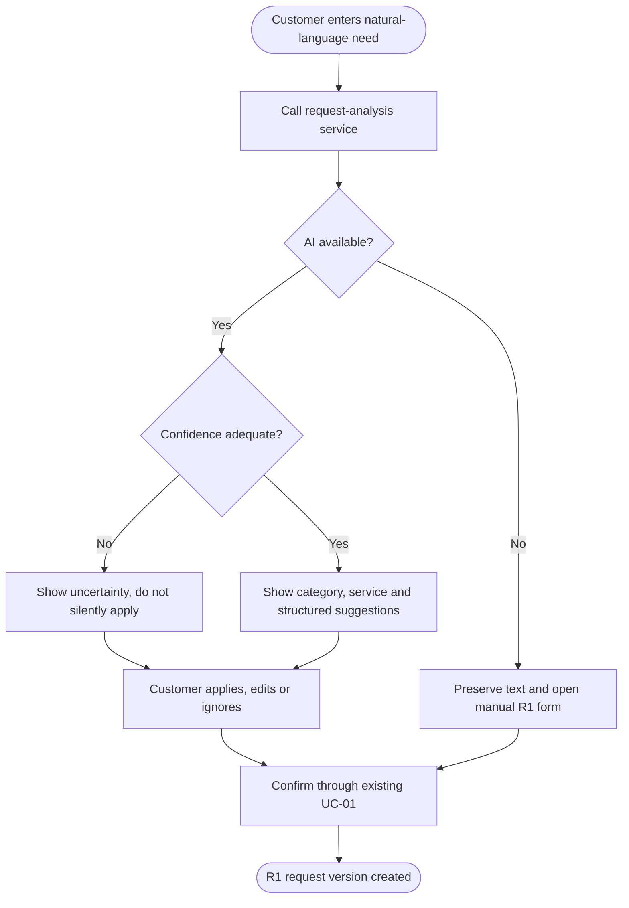

### 5.8 UC-AI-02: AI-Assisted Provider Recommendation, R2

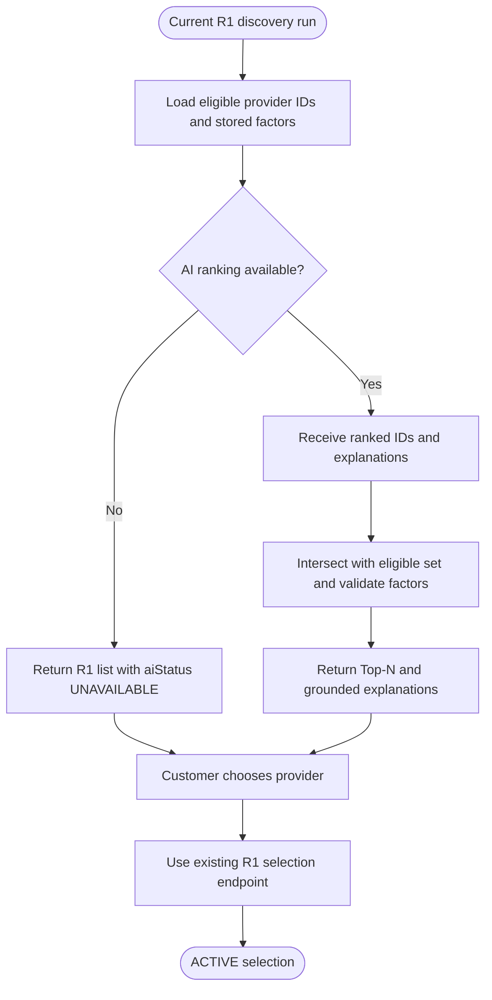

---

## 6. User Story Map

### 6.1 Customer Journey Story Map

| Journey Backbone | Discover | Request | Select | Agree | Receive Service | Close Transaction |
|---|---|---|---|---|---|---|
| R1 activity | Browse catalogue/providers | Create manual request | Run eligibility and choose provider | Review quotation and confirm booking | Track and complete service | Payment and review |
| R1 stories | US-CUS-01, 02 | US-CUS-03, 04 | US-CUS-05, 06 | US-CUS-07, 08 | US-CUS-09, 10 | US-CUS-11, 12 |
| R2 enhancement | AI service suggestion | AI prefill | AI ranking and explanation | No AI transaction control | No AI transaction control | Evaluation feedback only |
| R2 stories | US-AI-01 | US-AI-02 | US-AI-03, 04 | - | - | US-AI-05 |

### 6.2 Provider Journey Story Map

| Journey Backbone | Onboard | Become Eligible | Receive Opportunity | Quote | Fulfill | Build Reputation |
|---|---|---|---|---|---|---|
| R1 activity | Account/profile | Services, areas, availability, verification | Selected-request inbox | Draft and submit quotation | Start/complete booking | View reviews and rating |
| Stories | US-PRO-01 | US-PRO-02, 03, 04 | US-PRO-05 | US-PRO-06, 07 | US-PRO-08, 09 | US-PRO-10 |

### 6.3 Administrator Journey Story Map

| Journey Backbone | Govern Supply | Govern Taxonomy | Monitor Transactions | Moderate Trust | Audit |
|---|---|---|---|---|---|
| Stories | US-ADM-01, 02 | US-ADM-03 | US-ADM-04 | US-ADM-05 | US-ADM-06 |

### 6.4 Release Slices

| Slice | Objective | Included stories |
|---|---|---|
| R1.1 Foundation | Registered actors, catalogue and verified provider supply | US-CUS-01, 02; US-PRO-01..04; US-ADM-01..03 |
| R1.2 Request and Selection | Manual request, deterministic discovery, provider selection | US-CUS-03..06; US-PRO-05 |
| R1.3 Transaction Completion | Quotation, non-overlapping booking, fulfillment, payment and review | US-CUS-07..12; US-PRO-06..10; US-ADM-04..06 |
| R2 AI Enhancement | AI-assisted understanding/ranking with fallback and evaluation | US-AI-01..05 |

---

## 7. Detailed User Stories

### 7.1 Customer Stories

#### US-CUS-01: Register and authenticate

**As a** Guest, **I want** to register or login as a Customer **so that** I can create and manage service transactions.

**Acceptance criteria**

```gherkin
Given a new email and a valid password
When the Guest registers as Customer
Then one ACTIVE Customer account and Customer profile are created
And the user receives an access session

Given an email that differs only by letter case from an existing email
When registration is submitted
Then the system rejects it with EMAIL_ALREADY_REGISTERED
```

**Trace:** FR-ACC-01, FR-ACC-02.

#### US-CUS-02: Manage addresses

**As a** Customer, **I want** to maintain addresses with a governed district **so that** requests can be matched deterministically.

```gherkin
Given an ACTIVE district code
When the Customer creates an address
Then the address is stored and may be selected as default

Given an address used by a confirmed request
When the Customer later edits or deletes that address
Then the confirmed request keeps its original address snapshot
```

**Trace:** FR-CUS-02, FR-CUS-03, BR-SYS-14.

#### US-CUS-03: Save a service-request draft

**As a** Customer, **I want** to save an incomplete request **so that** I can finish it later.

```gherkin
Given a Customer has entered some request fields
When the Customer saves the draft
Then the request remains DRAFT
And the entered fields are available on resume
And no provider discovery can run yet
```

**Trace:** FR-SRQ-01 to FR-SRQ-04.

#### US-CUS-04: Confirm a versioned request

**As a** Customer, **I want** to review and confirm my request **so that** downstream processing uses an immutable requirement.

```gherkin
Given a valid DRAFT request
When the Customer confirms it with an idempotency key
Then exactly one immutable request version is created
And the request becomes CONFIRMED

Given the same idempotency key and same payload is retried
When confirmation is called again
Then the original response is returned
```

**Trace:** FR-SRQ-05, FR-SRQ-06, BR-SYS-14.

#### US-CUS-05: Discover eligible providers

**As a** Customer, **I want** to see providers meeting mandatory criteria **so that** I do not compare unsuitable providers.

```gherkin
Given a CONFIRMED request
When discovery runs
Then every returned provider supports the service
And has ACTIVE account and VERIFIED and active provider profile
And serves the request district
And has sufficient availability overlap

Given no provider remains after a filtering stage
Then the response contains a machine-readable no-result reason
```

**Trace:** FR-DIS-01 to FR-DIS-06, FR-DIS-08.

#### US-CUS-06: Select a provider

**As a** Customer, **I want** to choose one eligible provider **so that** that provider can prepare a quotation.

```gherkin
Given a provider appears in a discovery run for the current request version
When Customer selects that provider
Then eligibility is revalidated
And one ACTIVE selection is created
And request becomes PROVIDER_SELECTED

Given the request version changed after discovery
Then selection is rejected with a stale-version conflict
```

**Trace:** FR-DIS-07, BR-SYS-15.

#### US-CUS-07: Review a quotation

**As a** Customer, **I want** to review price, scope and exact scheduled slot **so that** I can make an informed commitment.

```gherkin
Given a SUBMITTED unexpired quotation for my request
When I open it
Then I see service description, cost breakdown, total VND amount, slot, validity and notes
```

**Trace:** FR-QUO-01, FR-QUO-02, FR-QUO-04.

#### US-CUS-08: Accept quotation without double booking

**As a** Customer, **I want** acceptance to atomically reserve the provider **so that** my booking is reliable.

```gherkin
Given a valid submitted quotation and a free provider slot
When Customer accepts with an idempotency key
Then exactly one CONFIRMED booking is created
And one ACTIVE provider reservation is created
And quotation becomes ACCEPTED
And request becomes BOOKED

Given another booking concurrently reserves an overlapping slot first
When acceptance commits
Then the entire transaction rolls back
And Customer receives 409 SLOT_UNAVAILABLE
```

**Trace:** FR-QUO-05, FR-BKG-01, FR-BKG-05, NFR-04.

#### US-CUS-09: Track booking

**As a** Customer, **I want** to see booking status and history **so that** I know whether the provider has started or completed the service.

```gherkin
Given I own a booking
When I open it
Then I see current status, scheduled slot, agreed amount and permitted history
```

**Trace:** FR-BKG-01.

#### US-CUS-10: Cancel allowed booking

**As a** Customer, **I want** to cancel a CONFIRMED booking with a reason **so that** the provider slot is released.

```gherkin
Given my booking is CONFIRMED
When I cancel with a reason
Then booking becomes CANCELLED
And its ACTIVE reservation becomes RELEASED

Given booking is IN_PROGRESS
When Customer attempts to cancel
Then the system rejects the transition
```

**Trace:** FR-BKG-04, FR-BKG-06.

#### US-CUS-11: Pay for completed service

**As a** Customer, **I want** to retry a failed demonstration payment **so that** I can complete the transaction without duplicate success records.

```gherkin
Given my booking is COMPLETED and has no PENDING or RECORDED attempt
When I create a payment attempt
Then one PENDING attempt is created for the agreed VND amount

Given the attempt fails
When I retry
Then a new numbered attempt may be created

Given a RECORDED payment already exists
When I create another attempt
Then it is rejected
```

**Trace:** FR-PAY-01 to FR-PAY-03.

#### US-CUS-12: Review completed and paid service

**As a** Customer, **I want** to rate a completed paid service **so that** provider reputation reflects verified transactions.

```gherkin
Given my booking is COMPLETED and has a RECORDED payment
And no review exists
When I submit rating 1 to 5 and an optional comment
Then one PUBLISHED review is created
And provider aggregate rating is recalculated

Given payment is not RECORDED
Then review submission is rejected
```

**Trace:** FR-REV-01, FR-REV-02, BR-SYS-12.

### 7.2 Provider Stories

| ID | User story | Acceptance summary | Trace |
|---|---|---|---|
| US-PRO-01 | As a Provider, I want to maintain a public profile so customers can assess my capability. | Required fields validated; public DTO excludes private/internal evidence. | FR-PRO-01 |
| US-PRO-02 | As a Provider, I want to declare services and indicative VND pricing so discovery can identify my capability. | Only active services; unique provider/service; price range valid. | FR-PRO-02, 05 |
| US-PRO-03 | As a Provider, I want to select districts and availability intervals so I receive geographically and temporally relevant work. | District codes active; provider availability does not overlap itself. | FR-PRO-03, 04 |
| US-PRO-04 | As a Provider, I want to submit verification so I can become discoverable. | Complete profile snapshot; admin approval required; only VERIFIED + active is eligible. | FR-PRO-06, FR-ADM-02 |
| US-PRO-05 | As a Provider, I want an inbox of active customer selections so I can decide whether to quote. | Only selections for the provider; customer contact/full address hidden before booking. | FR-QUO-01 |
| US-PRO-06 | As a Provider, I want to create a quotation with scope, price and exact slot so the customer understands the offer. | Total equals parts; VND; slot within availability. | FR-QUO-01, FR-PRO-04 |
| US-PRO-07 | As a Provider, I want to submit or withdraw the quotation so its lifecycle is explicit. | One open quotation; validity applied; withdrawal releases selection. | FR-QUO-02, FR-QUO-04 |
| US-PRO-08 | As the selected Provider, I want to start a confirmed job at the allowed time so service execution is traceable. | Only selected provider; start-window enforced; status becomes IN_PROGRESS. | FR-BKG-02 |
| US-PRO-09 | As the selected Provider, I want to complete an in-progress job so payment and review become available. | Status COMPLETED; completion time; reservation released; completed-job count increments. | FR-BKG-03, FR-BKG-06 |
| US-PRO-10 | As a Provider, I want to view published reviews and my aggregate rating so I understand my reputation. | Aggregate uses PUBLISHED eligible reviews only. | FR-REV-03 |

### 7.3 Administrator Stories

| ID | User story | Acceptance summary | Trace |
|---|---|---|---|
| US-ADM-01 | As an Administrator, I want to review Provider verification snapshots so only qualified providers become eligible. | Approve/reject/suspend with reason; audit generated. | FR-ADM-02, FR-PRO-06 |
| US-ADM-02 | As an Administrator, I want to suspend/reactivate users and providers so unsafe supply can be removed. | Refresh tokens revoked; suspended providers excluded from new discovery. | FR-ACC-04, FR-ADM-01 |
| US-ADM-03 | As an Administrator, I want to govern category, service and duration so requests use controlled taxonomy. | Activate/deactivate; referenced records not hard-deleted. | FR-CAT-02 to 04 |
| US-ADM-04 | As an Administrator, I want to search requests/bookings/payments so I can support the demo operation. | Filters by time/status; permission-controlled details. | FR-ADM-04 |
| US-ADM-05 | As an Administrator, I want to hide/restore inappropriate reviews so public reputation remains moderated. | Reason and audit required; aggregate recalculated. | FR-REV-04 |
| US-ADM-06 | As an Administrator, I want to inspect immutable audit events and basic trends so consequential operations are accountable. | Audit cannot be changed by app role; dashboard counts match source data. | FR-ADM-05, 06 |

### 7.4 R2 AI Stories

#### US-AI-01: Describe need in natural language

**As a** Customer, **I want** to describe my home-service problem in everyday language **so that** I receive suggested structured fields.

```gherkin
Given the R2 request-analysis feature is enabled
When the Customer submits a natural-language description
Then AI may suggest only approved fields
And no Service Request is created automatically
```

#### US-AI-02: Review AI suggestions

**As a** Customer, **I want** to apply, edit or ignore AI suggestions **so that** I retain control over my request.

```gherkin
Given suggestions are returned
When Customer reviews them
Then each suggestion can be applied, edited or ignored
And confirmation still uses the R1 request flow

Given AI is unavailable
Then the typed text is preserved
And the manual form is presented
```

#### US-AI-03: Receive ranked eligible providers

**As a** Customer, **I want** eligible providers ranked by relevant factors **so that** comparison effort is reduced.

```gherkin
Given a current R1 discovery run
When AI ranking succeeds
Then every returned provider belongs to that eligible set
And at most configured N providers are returned
```

#### US-AI-04: Understand recommendation factors

**As a** Customer, **I want** a grounded explanation **so that** I can judge whether the recommendation fits my need.

```gherkin
Given a ranked provider
When explanation is displayed
Then it cites only stored approved factors
And does not claim unavailable or sensitive attributes
```

#### US-AI-05: Compare AI with manual baseline

**As a** Project Team member, **I want** to evaluate AI on a separate dataset **so that** the thesis demonstrates measurable value rather than a demo-only claim.

```gherkin
Given a versioned evaluation dataset and configuration
When evaluation runs
Then request understanding reports Accuracy and F1
And recommendation reports Precision@K and NDCG@K
And results are compared with the documented R1/manual baseline
```

**Trace:** FR-AI-01 to 06, FR-AIM-01 to 07, NFR-14 to 17.

---

## 8. End-to-End Scenario Example

### Scenario: Air-conditioner repair

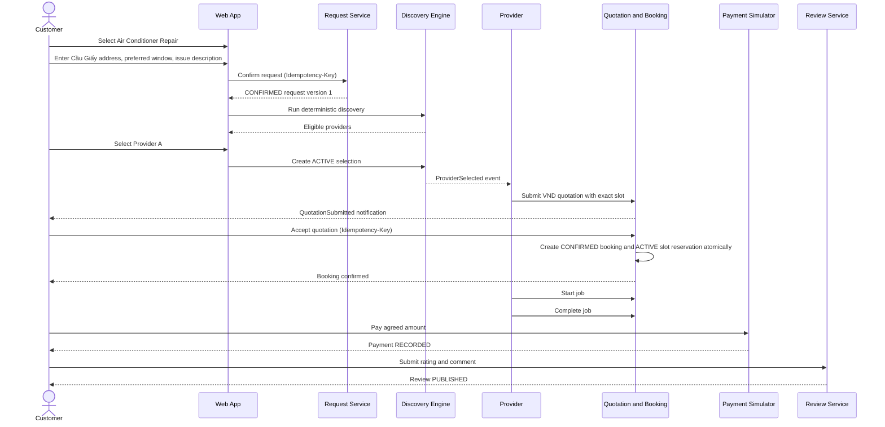

### Expected exception example

If Customer B concurrently accepts another quotation for Provider A with an overlapping slot, the database rejects the second active reservation. The whole second acceptance rolls back and Customer B receives `409 SLOT_UNAVAILABLE`; no duplicate booking remains.

---

## 9. Traceability Matrix

| Use Case | User Stories | Main SRS Requirements | Release |
|---|---|---|---|
| UC-01 Manual Request | US-CUS-02, 03, 04 | FR-CUS-02, 03; FR-SRQ-01..07 | R1 |
| UC-02 Discovery and Selection | US-CUS-05, 06 | FR-DIS-01..08 | R1 |
| UC-03 Quotation | US-PRO-05, 06, 07; US-CUS-07 | FR-QUO-01..05 | R1 |
| UC-04 Accept/Reject | US-CUS-08 | FR-QUO-03..05; FR-BKG-01, 05 | R1 |
| UC-05 Execute Job | US-CUS-09, 10; US-PRO-08, 09 | FR-BKG-01..06 | R1 |
| UC-06 Payment and Review | US-CUS-11, 12; US-PRO-10 | FR-PAY-01..03; FR-REV-01..03 | R1 |
| UC-AI-01 Request Assistance | US-AI-01, 02 | FR-AI-01..06 | R2 |
| UC-AI-02 Recommendation | US-AI-03, 04, 05 | FR-AIM-01..07 | R2 |
| Provider Governance | US-PRO-01..04; US-ADM-01, 02 | FR-PRO-01..07; FR-ADM-01, 02 | R1 |
| Platform Governance | US-ADM-03..06 | FR-CAT-02..04; FR-ADM-03..07 | R1 |

---

## 10. Definition of Ready and Definition of Done

### 10.1 Story Definition of Ready

- Actor and business value are clear.
- Related FR/BR IDs are linked.
- Acceptance criteria use observable Given/When/Then outcomes.
- Dependencies, error states and role/ownership constraints are stated.
- UI/API/database impact is identified in SD/DD.
- Test data requirements are known.

### 10.2 Story Definition of Done

- Acceptance criteria pass.
- Unit/integration tests for rules and state transitions pass.
- Authorization negative tests pass.
- OpenAPI contract and frontend integration are updated.
- Audit/metrics/logging are included where required.
- No new R1 dependency on AI is introduced.
- Critical R1 E2E regression remains green.

---

## 11. Open Questions

| ID | Question | Current recommendation |
|---|---|---|
| OQ-01 | Should discovery subtract already reserved slots? | Keep current SRS v0.3 behaviour for R1: eligibility uses declared availability; hard conflict check at quotation submission and acceptance. Improve in R1.1. |
| OQ-02 | How long is a quotation valid? | Configurable 48 hours. |
| OQ-03 | Is payment simulator enough for graduation acceptance? | Yes for R1; add sandbox only if time remains. |
| OQ-04 | What AI Top-N should be used? | Start with Top-5 for evaluation; confirm in R2 design. |

---

**End of Document — D02-A01 v0.1**
