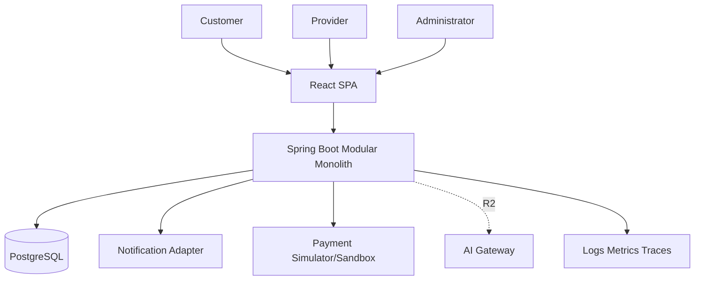
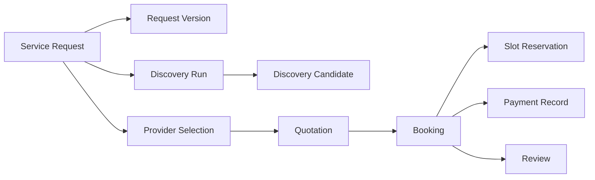

# System Architecture Design — Home Services Marketplace

**Project:** Home Services Marketplace  
**Version:** v0.2  
**Status:** Revised Draft  
**Date:** 2026-11-03  
**Baseline:** HLR v0.2 + SRS D02 v0.2  

## Revision v0.2
This revision incorporates the design review findings: booking-slot concurrency protection, lifecycle alignment, normalized ProviderSelection–Quotation relationships, persistent idempotency, single-success payment constraint, consistent HTTP error semantics, explicit AI degradation behavior, complete API coverage, area/timezone/currency decisions, review eligibility, browser token strategy, and fuller template sections.

> **Architecture rule:** AI depends on Core Marketplace; Core Marketplace must not depend on AI.

## 1. Purpose, Scope and Quality Drivers
R1 delivers a complete manual marketplace. R2 introduces optional AI assistance only after R1 acceptance. Main quality drivers are correctness of marketplace state, prevention of double booking, security, auditability, maintainability and graceful AI degradation.

### Non-goals
Real settlement/KYC, bidding, auto-dispatch, dynamic pricing, complex disputes, route optimisation and general-purpose chatbot.

## 2. Architecture Decisions
| ADR | Decision | Rationale |
|---|---|---|
| ADR-001 | R1 modular monolith | One transactional boundary and low operational overhead for a student team. |
| ADR-002 | PostgreSQL as source of truth | Strong constraints, transactions and range/exclusion capabilities. |
| ADR-003 | Deterministic eligibility before AI | Mandatory business rules remain explainable and testable. |
| ADR-004 | Provider selection is a first-class entity | Removes duplicated `selected_provider_id` ownership and anchors quotation. |
| ADR-005 | Slot reservation on quotation acceptance | Prevents two confirmed bookings for the same provider/time. |
| ADR-006 | Persistent idempotency records | Makes retries safe across process restarts. |
| ADR-007 | JWT access token in memory + rotating refresh token in Secure HttpOnly SameSite cookie | Avoids localStorage token exposure; refresh endpoint receives CSRF protection. |
| ADR-008 | R1 area model = governed province/district `area_code` | Deterministic and simple; radius/geospatial matching deferred. |
| ADR-009 | Canonical timezone `Asia/Ho_Chi_Minh`; persistence in UTC | Removes availability ambiguity for VN MVP. |
| ADR-010 | Currency = VND; monetary columns `NUMERIC(14,0)` | VND MVP does not require fractional units. |

## 3. System Context

## 4. Component Architecture
| Module | Responsibility | Data Owner |
|---|---|---|
| Identity | Accounts, role, tokens, status | user_account, refresh_token |
| Customer | Profile and address | customer_profile, customer_address |
| Provider | Profile, service, area, availability, verification | provider_* |
| Catalogue | Categories/services/areas | service_category, service, geo_area |
| Request | Draft, confirmation, immutable versions | service_request, request_version |
| Discovery | Eligibility runs and selection | discovery_run/candidate, provider_selection |
| Quotation | Quote lifecycle | quotation, quotation_item |
| Scheduling | Provider slot reservation | provider_slot_reservation |
| Booking | Booking and fulfillment state machine | booking, booking_history |
| Payment | Idempotent payment record | payment_record |
| Review | Review and reputation | review |
| Audit/Admin | Governance and audit | audit_event |
| Idempotency | Retry-safe consequential commands | idempotency_record |
| AI Adapter R2 | Request suggestions/ranking/fallback | ai_run, recommendation_result |

## 5. Processing Layers
1. **Presentation:** React routes/forms/access guards.
2. **API:** DTO validation, auth context and HTTP mapping.
3. **Application:** use-case orchestration and transaction boundaries.
4. **Domain:** aggregates, policies, state machines and eligibility rules.
5. **Infrastructure:** JPA, PostgreSQL, adapters and telemetry.
6. **External integration:** notification/payment; optional R2 AI.

## 6. Core State Models
### Service Request
`DRAFT → CONFIRMED → PROVIDERS_FOUND → PROVIDER_SELECTED → CANCELLED`

`PROVIDERS_FOUND` means a discovery run completed with at least one eligible provider. `CONFIRMED` remains unchanged when discovery returns none. `SEARCHING_PROVIDERS` is removed because R1 discovery is a synchronous query, not a persistent workflow stage.

### Booking
`CONFIRMED → IN_PROGRESS → COMPLETED`; `CONFIRMED/IN_PROGRESS → CANCELLED` according to policy.

`PENDING` is removed from the design because booking is created only after successful quotation acceptance and successful slot reservation.

### Other States
Provider: `DRAFT → PENDING_VERIFICATION → VERIFIED|REJECTED`; VERIFIED → SUSPENDED.  
Quotation: `DRAFT → SUBMITTED → ACCEPTED|REJECTED|WITHDRAWN|EXPIRED`.  
Payment: `PENDING → RECORDED|FAILED`. Review: `PUBLISHED ↔ HIDDEN`.

## 7. Scheduling and Double-Booking Protection
R1 uses `provider_slot_reservation(provider_id, booking_id, start_at, end_at, status)`.

On quotation acceptance, one database transaction:
1. Lock active quotation and selected provider context.
2. Revalidate request/selection/provider eligibility.
3. Attempt a provider slot reservation for `[start_at,end_at)`.
4. PostgreSQL exclusion constraint rejects overlapping ACTIVE reservations for the same provider.
5. Create exactly one CONFIRMED booking using unique `quotation_id`.
6. Mark quotation ACCEPTED; commit.

Recommended PostgreSQL constraint uses `btree_gist` and `EXCLUDE USING gist (provider_id WITH =, tstzrange(start_at,end_at,'[)') WITH &&) WHERE (status='ACTIVE')`.

## 8. Data Architecture and Ownership
Provider selection is the source of truth for selected provider. `service_request.selected_provider_id` is removed. Quotation references `selection_id`, not free-form request/provider pairs.

Confirmed request snapshots include `area_code`, address text/coordinates if available, `timezone=Asia/Ho_Chi_Minh`, requested start/end and budget currency VND.

## 9. API Architecture
Base `/api/v1`; JSON; OpenAPI 3.x. All consequential retries use persistent idempotency.

### Error Semantics
- 400 malformed syntax/request.
- 401 missing/invalid authentication.
- 403 authenticated but unauthorized.
- 404 inaccessible/missing resource.
- 409 resource state, concurrency or duplicate/idempotency conflict.
- 422 valid syntax but business validation failure.
- 503 external dependency unavailable when no degraded response exists.

### R2 Degradation Contract
- `/ai/request-analysis`: AI unavailable → `503 AI_UNAVAILABLE`; frontend preserves text and opens manual form.
- `/service-requests/{id}/recommendations`: AI unavailable → `200` with R1 eligible providers and `aiStatus: "UNAVAILABLE"`; no ranking score/explanation.

## 10. Security Architecture
- React keeps access token in memory only.
- Rotating refresh token stored in `Secure; HttpOnly; SameSite=Lax/Strict` cookie.
- Refresh/logout state-changing cookie endpoints validate CSRF token/origin.
- Spring Security enforces RBAC plus ownership.
- BCrypt/Argon2id password hashing; secrets externalized.
- Rate limits on auth/public search/AI.
- Sensitive actions emit immutable audit event.
- AI adapters receive allow-listed minimum fields only.

### Role Permissions Summary
| Capability | Customer | Provider | Admin |
|---|:---:|:---:|:---:|
| Create own request | ✓ |  |  |
| Select provider/accept quote | ✓ |  |  |
| Manage own capability/quote/job |  | ✓ |  |
| Verify/suspend provider |  |  | ✓ |
| Manage catalogue/moderate review |  |  | ✓ |

## 11. Reliability and Idempotency
`idempotency_record` persists `key, actor_id, operation, request_hash, status, response_code, response_body, created_at, expires_at` with unique `(actor_id, operation, key)`.

Algorithm: reserve key → if completed and same hash return stored response → if same key/different hash return 409 → execute transaction → persist response atomically where practical. Confirmation, quotation acceptance and payment-result processing use this mechanism.

Payment additionally enforces only one successful record per booking with a partial unique index where `status='RECORDED'`.

## 12. Infrastructure and Deployment
| Environment | Architecture |
|---|---|
| Local | Docker Compose: frontend, backend, PostgreSQL; adapters stubbed. |
| Test | Isolated test DB/schema, Testcontainers in CI, external stubs. |
| Demo/Staging | TLS reverse proxy/static frontend, backend container, PostgreSQL, telemetry. |

CI: lint → unit → integration/Testcontainers → SAST/dependency scan → image build → migration validation → deploy → smoke/E2E.

## 13. Monitoring, Error Handling and Recovery
Metrics: API p95/error, DB pool, discovery no-result, slot-conflict, quotation accept conflict, booking transition failures, payment retries, AI fallback. Structured logs include traceId and entity IDs but no secrets.

Recovery rules: transaction rollback on internal invariant failure; external notification after commit; bounded retry for idempotent adapter operations; AI circuit breaker/fallback; DB backup/restore procedure for demo/staging is required before final delivery.

## 14. NFR Architecture Mapping
| Quality | Design Mechanism |
|---|---|
| Security | JWT/cookie split, RBAC/ownership, TLS, validation, audit. |
| Reliability | transactions, exclusion/unique constraints, optimistic locks, idempotency. |
| Performance | indexed relational filtering; no AI on R1 critical path. |
| Maintainability | module boundaries, ports/adapters, Flyway, automated tests. |
| Availability | AI not part of R1 readiness; degraded R1 result. |
| Traceability | snapshots, history tables, audit events, trace IDs. |

## 15. Assumptions, Risks and Open Decisions
Assumptions: VN MVP, `Asia/Ho_Chi_Minh`, VND, district/province area model, demo payment. Review eligibility in v0.2 is **COMPLETED booking + payment RECORDED** before publishing a review. Cancellation fees remain out of scope.

Open: hosting provider, exact refresh TTL, quotation default expiry, cancellation actor matrix, notification provider, performance workload, retention period and R2 AI provider/model.
