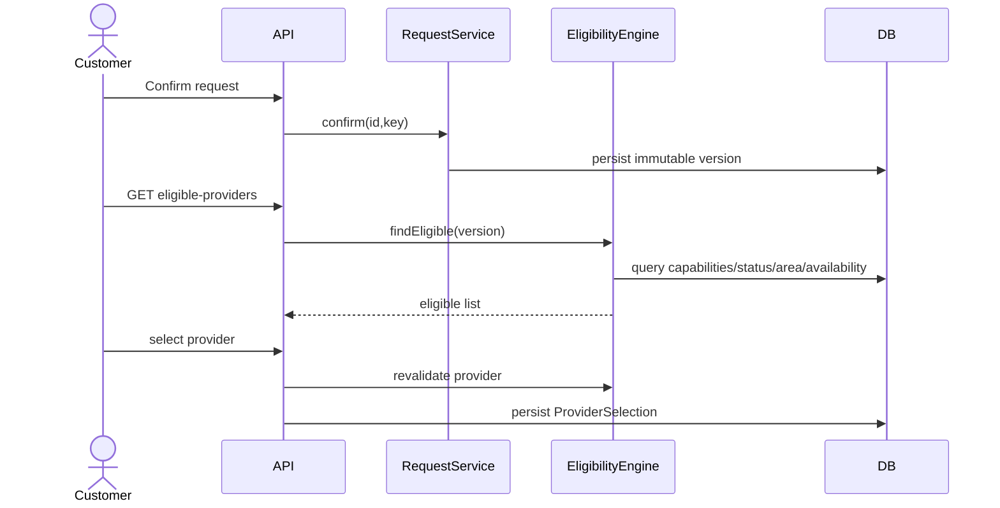
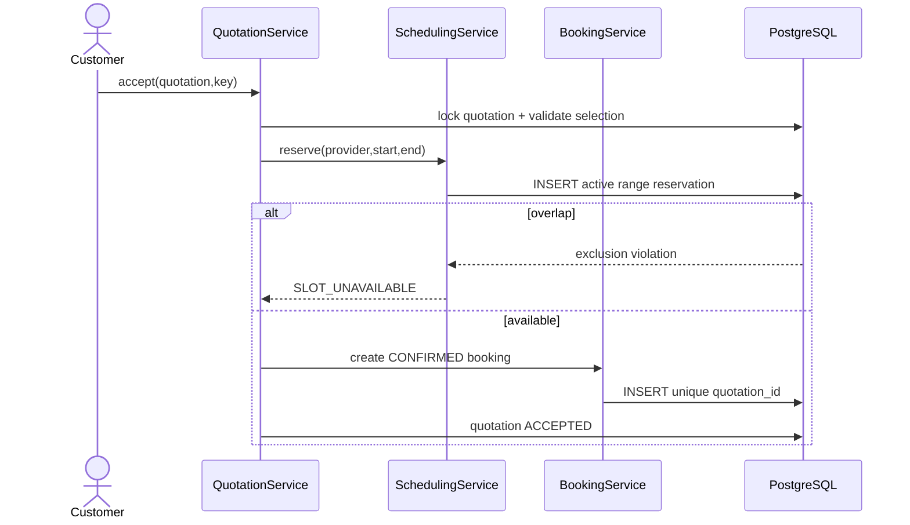

# System Design Document — Home Services Marketplace

**Project:** Home Services Marketplace  
**Version:** v0.2  
**Status:** Revised Draft  
**Date:** 2026-11-03  
**Baseline:** HLR v0.2 + SRS D02 v0.2  

## Revision v0.2
This revision incorporates the design review findings: booking-slot concurrency protection, lifecycle alignment, normalized ProviderSelection–Quotation relationships, persistent idempotency, single-success payment constraint, consistent HTTP error semantics, explicit AI degradation behavior, complete API coverage, area/timezone/currency decisions, review eligibility, browser token strategy, and fuller template sections.

> **Architecture rule:** AI depends on Core Marketplace; Core Marketplace must not depend on AI.

## 1. Scope and Design Goals
Translate HLR/SRS into deployable module, runtime, interface, data and operational designs. R1 is AI-independent. R2 plugs into stable R1 ports.

## 2. Distribution and Stakeholders
One backend deployment for R1; frontend static deployment; one PostgreSQL database. External payment/notification are adapters; AI is optional R2. Customer, Provider and Admin access separate route groups but share the same API.

## 3. Requirements and NFR Targets
| Requirement | Design |
|---|---|
| Manual R1 E2E | No AI dependency in request/discovery/transaction modules. |
| Prevent double booking | DB-enforced interval reservation during acceptance. |
| Retry safety | Persistent idempotency store and unique constraints. |
| Provider eligibility | Deterministic EligibilityEngine and selection-time revalidation. |
| R2 fallback | Feature flags, timeout/circuit breaker and degraded contract. |
| Performance | Proposed: simple query p95 ≤500ms, transactional command p95 ≤1s, discovery p95 ≤2s at agreed MVP load; TBC after load plan. |

## 4. Module Design
| Module | Public Application Interfaces | Repository Boundary |
|---|---|---|
| Request | CreateDraft, UpdateDraft, Confirm, Cancel | ServiceRequestRepository |
| Discovery | FindEligible, SelectProvider | DiscoveryRepository, SelectionRepository |
| Quotation | Create/Submit/Withdraw/Accept/Reject | QuotationRepository |
| Scheduling | ReserveSlot, ReleaseSlot | SlotReservationRepository |
| Booking | Get, Start, Complete, Cancel | BookingRepository |
| Payment | CreateAttempt, RecordResult | PaymentRepository |
| Review | Submit, Hide, Restore | ReviewRepository |
| Provider/Admin | Verify, Suspend, Catalogue commands | Provider/Catalog repositories |
| AI R2 | AnalyzeRequest, Recommend | AiRunRepository + ports |

## 5. Runtime Design
### 5.1 Manual Request and Discovery

Request state goes `DRAFT → CONFIRMED → PROVIDERS_FOUND → PROVIDER_SELECTED`. No persistent SEARCHING state.

### 5.2 Quotation Acceptance and Slot Reservation

### 5.3 Booking State
Only `CONFIRMED`, `IN_PROGRESS`, `COMPLETED`, `CANCELLED` are persisted. This design intentionally removes unused PENDING state from the earlier SRS wording and must be synchronized to the next SRS baseline.

### 5.4 Payment and Review
Payment success uses a partial unique constraint for one `RECORDED` payment per booking. Review publication requires Booking=COMPLETED and Payment=RECORDED; one active review per booking.

### 5.5 R2 Degradation
AI request-analysis returns 503 and UI switches to manual entry. AI recommendation failure returns the R1 eligible list as HTTP 200 with explicit `aiStatus=UNAVAILABLE` and no score/explanation.

## 6. Data Design
### Core Normalization
`ProviderSelection` references ServiceRequest + requestVersion + provider. `Quotation` references `selection_id`. `Booking` references accepted `quotation_id`. ServiceRequest does not duplicate selected provider.

### Scheduling
Reservation time is `[start_at,end_at)` UTC. UI accepts/prints VN local time. Constraint prevents overlap on ACTIVE reservation for same provider.

### Area
`geo_area(code,parent_code,name,type,active)`; address snapshot stores `area_code`. Provider area references the same governed code. R1 area eligibility is exact or ancestor/descendant according to configured district/province rule.

## 7. API Design
### Customer/Request
- `POST /api/v1/service-requests`
- `PUT /api/v1/service-requests/{id}`
- `POST /api/v1/service-requests/{id}/confirm`
- `POST /api/v1/service-requests/{id}/cancel`
- `GET /api/v1/service-requests/{id}/eligible-providers`
- `PUT /api/v1/service-requests/{id}/provider-selection`

### Provider/Quotation
- `POST /api/v1/provider/requests/{id}/quotations`
- `POST /api/v1/quotations/{id}/submit`
- `POST /api/v1/quotations/{id}/withdraw`
- `POST /api/v1/quotations/{id}/accept`
- `POST /api/v1/quotations/{id}/reject`

Rule: max one active `SUBMITTED` quotation for a ProviderSelection; a new version requires previous quote withdrawn/expired/rejected according to policy.

### Booking/Payment/Review
- `GET /api/v1/bookings/{id}`
- `POST /api/v1/bookings/{id}/start|complete|cancel`
- `POST /api/v1/bookings/{id}/payments`
- `POST /api/v1/payments/{id}/result` (simulator/admin callback)
- `POST /api/v1/bookings/{id}/reviews`

### Provider/Admin/Catalogue
CRUD/profile/address/catalogue endpoints, provider verification/suspension, moderation and audit-query endpoints are documented in OpenAPI; all writes use authorization and relevant version/idempotency controls.

### Errors
409 = stale state, concurrency, duplicate/idempotency/slot conflict. 422 = business validation while resource state is otherwise current.

## 8. Event Contracts
Events are in-process/post-commit in R1; no broker required.
| Event | Producer | Consumer | Failure Behavior |
|---|---|---|---|
| QuotationSubmitted | Quotation | Notification | Retry/log; transaction remains committed. |
| BookingConfirmed | Booking | Notification | Same. |
| BookingCompleted | Booking | Payment/Notification | Payment record creation is transactional/application call; notification post-commit. |
| ReviewPublished | Review | Reputation | Aggregate update in same transaction or deterministic recompute. |

## 9. Trust Boundaries and Security
Browser ↔ API and API ↔ external adapters are trust boundaries. Access token memory-only; refresh cookie HttpOnly/Secure/SameSite and rotated. CSRF protection/origin check for cookie-auth endpoints. Admin, Provider and Customer permissions are explicitly tested with negative paths.

## 10. Reliability and Recovery
- Quotation acceptance uses row locking + DB constraint.
- Booking state commands use optimistic version.
- Idempotency store persists responses across restarts.
- Notification is accepted at-least-once/best-effort risk for MVP; lost notification does not alter transaction truth.
- AI and payment adapters have timeout/circuit breaker; only idempotent operations are retried.

## 11. Deployment Units
| Unit | Artifact | Config |
|---|---|---|
| Frontend | static React bundle | API base URL, feature flags |
| Backend | OCI image/JAR | DB, JWT, adapters, timezone, currency |
| Database | PostgreSQL + Flyway | schema/backup credentials |
| AI R2 | external model through backend gateway | API key, model, timeout, flags |

## 12. Backup, Recovery and Runbook
Daily demo/staging PostgreSQL backup is recommended; restore is rehearsed before final demo. Runbook covers DB unavailable, migration failure, payment adapter unavailable, AI unavailable, high 409 slot-conflict rate, and rollback to previous application image.

## 13. High-Risk Scenarios
| Scenario | Expected Design Response |
|---|---|
| Two customers accept overlapping bookings | One wins reservation; second receives 409 SLOT_UNAVAILABLE. |
| Duplicate quotation accept request | Same key/payload returns same booking; different payload/key conflict handled safely. |
| Provider suspended after discovery | Selection/acceptance revalidates and fails with 422 PROVIDER_NOT_ELIGIBLE. |
| Payment callback repeated | Existing recorded result returned; no second success. |
| AI fails | R1 remains usable. |

## 14. Assumptions, Constraints and Dependencies
VN MVP, `Asia/Ho_Chi_Minh`, VND, province/district areas, payment simulator/sandbox. PostgreSQL range exclusion is a deliberate technology dependency. Notification provider and R2 model remain TBC.

## 15. Traceability and Required SRS Synchronization
Design review changes requiring the next SRS update: remove `SEARCHING_PROVIDERS`; remove Booking `PENDING`; define payment-recorded review eligibility; define slot-conflict behavior. All other requirement IDs remain mapped by existing capability groups.
