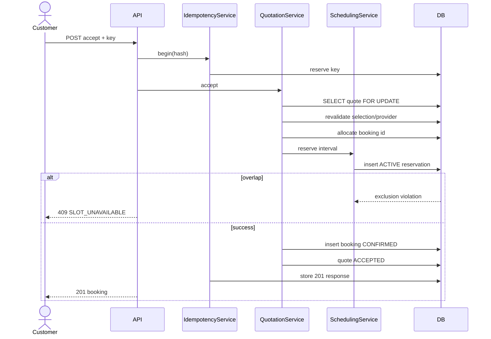

# Detailed Design Document — Home Services Marketplace

**Project:** Home Services Marketplace  
**Version:** v0.2  
**Status:** Revised Draft  
**Date:** 2026-11-03  
**Baseline:** HLR v0.2 + SRS D02 v0.2  

## Revision v0.2
This revision incorporates the design review findings: booking-slot concurrency protection, lifecycle alignment, normalized ProviderSelection–Quotation relationships, persistent idempotency, single-success payment constraint, consistent HTTP error semantics, explicit AI degradation behavior, complete API coverage, area/timezone/currency decisions, review eligibility, browser token strategy, and fuller template sections.

> **Architecture rule:** AI depends on Core Marketplace; Core Marketplace must not depend on AI.


## 1. Approval Status
Draft for technical review. Implementation must not baseline lifecycle changes until the corresponding SRS update is accepted.

## 2. Design Goals / Non-goals
**Goals:** implementation-ready R1, DB-enforced scheduling integrity, retry safety, explicit APIs/errors, testability and R2 extension seams.  
**Non-goals:** distributed microservices, real settlement/KYC, AI algorithm internals.

## 3. Detailed Design Decisions
| DD | Decision |
|---|---|
| DD-01 | ProviderSelection is normalized; Quotation references selection_id. |
| DD-02 | Booking created directly CONFIRMED after successful acceptance/reservation. |
| DD-03 | SEARCHING_PROVIDERS is not persisted for synchronous discovery. |
| DD-04 | PostgreSQL exclusion constraint protects provider schedule intervals. |
| DD-05 | Persistent idempotency store handles consequential commands. |
| DD-06 | Only one RECORDED payment per booking. |
| DD-07 | Review requires COMPLETED + RECORDED payment. |
| DD-08 | AI request failure = 503/manual UI; recommendation failure = degraded 200 eligible list. |
| DD-09 | Access token memory; refresh token secure HttpOnly cookie with rotation. |

## 4. Quality Attributes
Correctness > availability for transaction commits; R1 availability > AI availability; security/traceability mandatory; performance targets proposed: query p95≤500ms, command≤1s, discovery≤2s, TBC by load plan.

## 5. Package Structure
```text
backend/com.homeservices
  shared/{security,error,idempotency,audit,time}
  identity/{api,application,domain,infra}
  provider/{api,application,domain,infra}
  catalog/{...}
  request/{...}
  discovery/{...}
  quotation/{...}
  scheduling/{...}
  booking/{...}
  payment/{...}
  review/{...}
  admin/{...}
  ai/{port,adapter,application,infra}
```

## 6. Component Specifications
### CMP-RQ-01 ServiceRequestService
**Responsibility:** lifecycle DRAFT/CONFIRMED/PROVIDERS_FOUND/PROVIDER_SELECTED/CANCELLED, immutable request versions.  
**Non-responsibility:** provider ranking, quotation.  
**Interface:** `createDraft`, `updateDraft`, `confirm`, `markProvidersFound`, `markProviderSelected`, `cancel`.  
**Errors:** REQUEST_NOT_DRAFT(409), INVALID_SERVICE(422), INVALID_SCHEDULE(422).  
**Observability:** request_confirm_total, trace/entity IDs.

### CMP-DIS-01 EligibilityEngine
**Input:** confirmed request version and optional UI filters.  
**Rules in order:** service → active/VERIFIED → area → availability.  
**Output:** eligible providers and non-sensitive reason codes for diagnostics.  
**Non-responsibility:** qualitative ranking/AI.  
**Selection:** recompute the selected provider against current transaction time and request version.

### CMP-SCH-01 SchedulingService
`reserve(providerId, bookingId, startAt, endAt)` inserts an ACTIVE reservation. PostgreSQL exclusion violation maps to `SLOT_UNAVAILABLE` HTTP 409. `release(bookingId)` changes reservation to RELEASED when cancellation policy permits.

### CMP-QUO-01 QuotationService
`createDraft(selectionId)`, `submit`, `withdraw`, `accept`, `reject`. Only selected provider owns quote; only owning customer accepts/rejects. At most one active submitted quote per selection.

`accept()` transaction: reserve idempotency → lock quotation → validate ownership/status/expiry → validate provider/selection → create provisional booking id → reserve slot → insert booking CONFIRMED → mark accepted → complete idempotency record → commit → notify after commit.

### CMP-BKG-01 BookingService
`start(id, version)`, `complete(id, version)`, `cancel(id, version, reason)`. Optimistic lock protects update. Booking never returns to previous state. Cancel releases active slot.

### CMP-PAY-01 PaymentService
`createAttempt(bookingId)`, `recordResult(adapter,externalRef,result,key)`. No card/secret data persisted. A successful payment is terminal for MVP.

### CMP-REV-01 ReviewService
`submit(bookingId,rating,comment)` checks customer ownership, COMPLETED and RECORDED payment. Unique booking constraint prevents second review. Moderation changes status only and records audit.

### CMP-IDEM-01 IdempotencyService
`begin(actor,operation,key,requestHash)` returns NEW, REPLAY(response), IN_PROGRESS or CONFLICT. TTL proposed 24h for commands; retention TBC. Stored response is sanitized JSON.

### CMP-AI-01 AiGateway R2
Ports `analyze()` and `rank()`. Feature flags default false. All calls have timeout and correlation ID. Rank output is intersected with the eligible-provider set before UI response.

## 7. Database DDL Sketch
```sql
CREATE EXTENSION IF NOT EXISTS btree_gist;

CREATE TABLE provider_selection (
 id uuid PRIMARY KEY,
 request_id uuid NOT NULL,
 request_version int NOT NULL,
 provider_id uuid NOT NULL,
 selected_by uuid NOT NULL,
 selected_at timestamptz NOT NULL,
 UNIQUE(request_id, request_version)
);

CREATE TABLE quotation (
 id uuid PRIMARY KEY,
 selection_id uuid NOT NULL REFERENCES provider_selection(id),
 status varchar(20) NOT NULL,
 total numeric(14,0) NOT NULL CHECK(total >= 0),
 currency char(3) NOT NULL DEFAULT 'VND',
 service_start timestamptz NOT NULL,
 service_end timestamptz NOT NULL,
 valid_until timestamptz,
 version bigint NOT NULL DEFAULT 0,
 CHECK(service_start < service_end)
);
CREATE UNIQUE INDEX uq_quote_active_selection ON quotation(selection_id)
 WHERE status='SUBMITTED';

CREATE TABLE booking (
 id uuid PRIMARY KEY,
 quotation_id uuid NOT NULL UNIQUE REFERENCES quotation(id),
 customer_id uuid NOT NULL,
 provider_id uuid NOT NULL,
 status varchar(20) NOT NULL,
 start_at timestamptz NOT NULL,
 end_at timestamptz NOT NULL,
 version bigint NOT NULL DEFAULT 0,
 CHECK(start_at < end_at)
);

CREATE TABLE provider_slot_reservation (
 id uuid PRIMARY KEY,
 provider_id uuid NOT NULL,
 booking_id uuid NOT NULL UNIQUE REFERENCES booking(id),
 start_at timestamptz NOT NULL,
 end_at timestamptz NOT NULL,
 status varchar(20) NOT NULL,
 CHECK(start_at < end_at)
);
ALTER TABLE provider_slot_reservation ADD CONSTRAINT ex_provider_active_slot
 EXCLUDE USING gist (provider_id WITH =, tstzrange(start_at,end_at,'[)') WITH &&)
 WHERE (status='ACTIVE');

CREATE TABLE idempotency_record (
 id uuid PRIMARY KEY,
 actor_id uuid NOT NULL,
 operation varchar(80) NOT NULL,
 idem_key varchar(120) NOT NULL,
 request_hash varchar(64) NOT NULL,
 status varchar(20) NOT NULL,
 response_code int,
 response_body jsonb,
 created_at timestamptz NOT NULL,
 expires_at timestamptz NOT NULL,
 UNIQUE(actor_id,operation,idem_key)
);

CREATE TABLE payment_record (
 id uuid PRIMARY KEY,
 booking_id uuid NOT NULL REFERENCES booking(id),
 adapter varchar(50) NOT NULL,
 external_ref varchar(120),
 status varchar(20) NOT NULL,
 amount numeric(14,0) NOT NULL,
 currency char(3) NOT NULL DEFAULT 'VND'
);
CREATE UNIQUE INDEX uq_payment_external ON payment_record(adapter,external_ref) WHERE external_ref IS NOT NULL;
CREATE UNIQUE INDEX uq_booking_recorded_payment ON payment_record(booking_id) WHERE status='RECORDED';

CREATE TABLE review (
 id uuid PRIMARY KEY,
 booking_id uuid NOT NULL UNIQUE REFERENCES booking(id),
 customer_id uuid NOT NULL,
 provider_id uuid NOT NULL,
 rating smallint NOT NULL CHECK(rating BETWEEN 1 AND 5),
 comment varchar(1000),
 status varchar(20) NOT NULL DEFAULT 'PUBLISHED'
);
```

`request_version.address_snapshot` must include governed `areaCode`; all timestamps stored UTC and converted to `Asia/Ho_Chi_Minh` at boundaries.

## 8. API Contracts
All write DTOs use validation annotations; OpenAPI is generated/checked in CI.

| Operation | Endpoint | Success | Key Errors |
|---|---|---:|---|
| Confirm request | POST `/service-requests/{id}/confirm` | 200 | 409 stale/state; 422 invalid fields |
| Eligible providers | GET `/service-requests/{id}/eligible-providers` | 200 | 422 request not confirmed |
| Select provider | PUT `/service-requests/{id}/provider-selection` | 200 | 409 stale request; 422 not eligible |
| Submit quote | POST `/quotations/{id}/submit` | 200 | 409 invalid state; 422 quote validation |
| Accept quote | POST `/quotations/{id}/accept` | 201 | 409 expired/state/slot/idempotency conflict; 422 provider invalid |
| Start/complete/cancel | POST `/bookings/{id}/{command}` | 200 | 409 invalid transition/version |
| Payment result | POST `/payments/{id}/result` | 200 | 409 conflicting result |
| Submit review | POST `/bookings/{id}/reviews` | 201 | 409 duplicate; 422 not eligible |
| AI analyze R2 | POST `/ai/request-analysis` | 200 | 503 AI unavailable |
| AI recommend R2 | POST `/service-requests/{id}/recommendations` | 200 | Degraded 200 on AI failure |

## 9. Frontend Detailed Design
React + TypeScript, React Router, TanStack Query, React Hook Form + schema validation. Access token is memory-only; refresh uses credentialed cookie call.

Routes: `/customer/requests/new`, `/requests/:id/providers`, `/quotations/:id`, `/bookings/:id`, `/provider/requests/:id/quote`, `/admin/providers`, `/admin/catalog`, R2 `/requests/new/ai`.

On 409 slot conflict, quotation page refreshes provider/slot data and shows “Khung giờ vừa được đặt; hãy chọn thời gian khác hoặc yêu cầu báo giá mới.” On AI recommendation degraded 200, UI labels results “Eligible providers” and omits scores/explanations.

## 10. Detailed Sequence: Accept Quotation


## 11. Error, Concurrency and Recovery
409 is reserved for state/concurrency/replay conflicts; 422 for current-state business validation. `@Version` protects Booking/Provider changes; quotation acceptance uses row lock because only one winner is allowed. External adapter failures never corrupt domain state.

## 12. Security Detail
Access JWT in memory, 5–15 minute target lifetime TBC. Refresh cookie Secure/HttpOnly/SameSite; token rotation and server-side revocation record. CORS allow-list for frontend origin. Cookie-auth refresh/logout require CSRF token or strict origin/custom-header strategy. Public DTO excludes contact/verification evidence. Negative authorization tests are mandatory.

## 13. Observability
Each request carries `traceId`. Audit events include actor/action/entity/before-after summary/reason. Metrics include slot reservation conflict, idempotency replay/conflict, payment duplicate prevention, provider eligibility exclusion counts and AI degradation.

Logs are centralized via an ELK stack (Elasticsearch + Logstash + Kibana). The backend writes structured JSON lines (Spring Boot structured logging, `logstash` format) to `backend/logs/hsm-backend.json`; every line carries the request `traceId`, actor (`userId`/`role`) and access fields (`http_method`/`http_status`/`http_duration_ms`). Logstash tails the file and indexes daily `hsm-logs-YYYY.MM.dd` indices; Kibana exposes a `hsm-logs-*` data view and an "HSM Observability" dashboard. A 30-day ILM policy governs retention. Logging is fail-open — an ELK outage never affects transactions. Run and validation steps: `infra/elk/README.md` and `specs/002-elk-logging/quickstart.md`.

## 14. Test Design
- Unit: every eligibility rule; request/quotation/booking state transitions; payment/review eligibility.
- DB/Testcontainers: GiST overlapping reservation race using two concurrent transactions; unique booking/payment/review; active quote constraint; idempotency concurrency.
- Integration: RBAC/ownership matrix; full APIs and error mapping.
- E2E Playwright: manual R1 journey, no-provider, slot-race recovery, cancellation, duplicate accept, payment retry, review eligibility.
- R2: AI failure fallback, eligible-set intersection, Golden Dataset metrics and full R1 regression.

## 15. Implementation and Migration Plan
Migration order: area/catalog → identity/customer/provider → request/version → discovery/selection → quotation → booking/reservation → idempotency → payment/review/audit → R2 AI. Feature flags keep R2 off. Backward-compatible migrations precede app deployment.

## 16. Open Items
Refresh TTL, quotation expiry default, exact cancellation actor matrix, payment simulator, notification implementation, performance workload, retention periods and R2 model/provider remain TBC.
