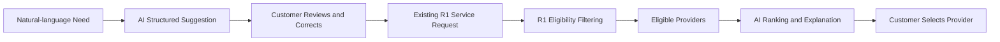

# High-Level Requirements (HLR)

## Home Services Marketplace — Core Marketplace with Planned AI Enhancement

| Item | Detail |
|---|---|
| Document | High-Level Requirements — Home Services Marketplace |
| Project | Home Services Marketplace with planned AI-assisted matching |
| Client | Student Graduation Project |
| Version | 0.2 |
| Date | 2026-11-03 |
| Audience | Supervisor, business stakeholders, project team, solution reviewer |
| Purpose | Define business capabilities and high-level requirements for R1 Core Marketplace and R2 AI Enhancement |
| Related document | SRS D02 Draft v0.2 |
| Supersedes | HLR Home Services Marketplace v0.1 |
| Priority legend | **M** = Must have · **S** = Should have · **O** = Optional |

## Change History

| Version | Date | Summary |
|---|---|---|
| 0.1 | 2026-11-02 | Initial HLR based on Proposal/SOW and the first SRS draft. |
| 0.2 | 2026-11-03 | Reworked to a business-complete HLR. R1 delivers the full manual marketplace workflow; AI-assisted understanding and recommendation move to R2 after the R1 phase gate. Added business context, outcomes, operating flows, capability-grouped HLRs, cross-cutting rules, NFRs, delivery approach, success criteria, glossary and traceability. |

## v0.2 Direction Change

| # | Area | Change from v0.1 |
|---:|---|---|
| 1 | Delivery baseline | The complete marketplace transaction lifecycle is implemented and validated before AI integration. |
| 2 | Service Request | R1 uses manual category/service selection and structured input. Natural-language understanding is R2 only. |
| 3 | Provider discovery | R1 uses deterministic eligibility filtering and customer-led selection. AI ranking is R2 only. |
| 4 | AI dependency | AI depends on Core Marketplace; Core Marketplace must never depend on AI. |
| 5 | Fallback | Manual request creation and provider discovery remain available after R2 is enabled. |
| 6 | Evaluation | R1 becomes the manual baseline for measuring the added value of R2. |
| 7 | Naming | R1 screens and states use “Eligible Providers / Provider Discovery”, not mandatory “AI Matching”. |

---

## 1. Executive Summary

Home Services Marketplace connects customers who need on-site household services with verified service providers. It supports the complete transaction lifecycle from service discovery and request creation through provider selection, quotation, booking, fulfillment, payment recording and review.

The delivery is intentionally divided into two releases:

- **R1 — Core Marketplace:** customers manually select a category and service, enter structured request details, browse providers that pass deterministic eligibility rules, and select a provider. No AI capability is required.
- **R2 — AI Enhancement:** after R1 is stable, AI may assist natural-language requirement understanding and rank providers that already passed R1 eligibility filtering. The customer remains the final decision-maker.

### Expected Business Outcomes

| Outcome | Description |
|---|---|
| Easier service discovery | Customers can browse a governed service catalogue and create a request using a clear guided form. |
| Qualified provider visibility | Only active, verified providers that support the requested service, area and schedule are shown. |
| Transaction traceability | Requests, provider selection, quotations, bookings, fulfillment, payment records and reviews remain linked and auditable. |
| Provider trust | Verification status, completed-work history and eligible reviews support informed customer decisions. |
| Repeatable operating process | Customers and providers follow one consistent lifecycle rather than coordinating entirely outside the platform. |
| Independent Core Marketplace | The end-to-end business process works even when AI is disabled, unavailable or not yet delivered. |
| Measurable AI improvement | R1 provides a baseline for evaluating whether R2 improves discovery time, recommendation relevance or user effort. |
| Safer AI adoption | AI suggestions are advisory, confirmable and unable to bypass mandatory eligibility or create transactions automatically. |

---

## 2. Business Context and Objectives

### 2.1 Business Problems

| Problem | Business Impact |
|---|---|
| Customers may not know which service category fits their problem. | Discovery takes longer and requests may be classified incorrectly. |
| Provider capability, area, availability, pricing and reputation are fragmented. | Customers spend significant effort comparing options and may select an unsuitable provider. |
| Provider verification is inconsistent outside a managed platform. | Customer trust is reduced and low-quality providers may receive work. |
| Quotation and booking decisions are commonly exchanged through disconnected channels. | Scope, price, schedule and acceptance evidence are difficult to trace. |
| Job status and completion evidence are not centrally recorded. | Customers, providers and administrators cannot reliably determine transaction state. |
| Reviews may not be tied to completed services. | Provider ratings are vulnerable to low-quality or ineligible feedback. |
| Introducing AI before the manual process is stable obscures product defects. | The team cannot distinguish weak business rules from weak AI results or quantify AI benefit. |

### 2.2 Objectives

| ID | Objective |
|---|---|
| OBJ-01 | Provide a structured service catalogue for discovering home-service categories and services. |
| OBJ-02 | Allow customers to create and confirm a Service Request without AI. |
| OBJ-03 | Allow providers to declare services, coverage, availability and indicative pricing. |
| OBJ-04 | Ensure only active and verified providers enter the eligible candidate set. |
| OBJ-05 | Enable customers to compare eligible providers and make the final selection. |
| OBJ-06 | Support quotation acceptance, booking, fulfillment, payment recording and review as one traceable lifecycle. |
| OBJ-07 | Provide administrator controls for provider verification, catalogue governance, monitoring, moderation and audit. |
| OBJ-08 | Complete and validate R1 before enabling any R2 AI capability. |
| OBJ-09 | In R2, assist requirement understanding while preserving human correction and manual fallback. |
| OBJ-10 | In R2, rank only eligible providers and provide evidence-based recommendation explanations. |
| OBJ-11 | Measure AI-assisted outcomes against the R1 manual baseline using an evaluation dataset and agreed metrics. |

### 2.3 Business Principles

1. **Manual-first:** all critical marketplace journeys must work without AI.
2. **Eligibility before ranking:** mandatory business rules always execute before optional AI ranking.
3. **Human decision:** the customer selects the provider and confirms AI-generated request data.
4. **Traceability:** consequential state changes retain actor, timestamp and linked business context.
5. **No hidden automation:** AI does not create bookings, accept quotations, record payment or publish reviews.
6. **Historical integrity:** transaction data with history is not hard-deleted.

---

## 3. Scope

### 3.1 R1 — Core Marketplace In Scope

| Epic | Capability |
|---|---|
| Epic 1 | Account registration, authentication, RBAC and account status. |
| Epic 2 | Customer profile, address book and transaction history. |
| Epic 3 | Provider onboarding, capability profile, service area, availability, pricing and verification. |
| Epic 4 | Service category and service catalogue governance. |
| Epic 5 | Manual guided Service Request creation, draft, validation, review and confirmation. |
| Epic 6 | Deterministic provider eligibility filtering, provider profile comparison and manual selection. |
| Epic 7 | Quotation creation, submission, acceptance, rejection, expiry and withdrawal. |
| Epic 8 | Booking confirmation, job start, completion, cancellation and history. |
| Epic 9 | Demonstration-compatible payment recording and eligible review submission. |
| Epic 10 | Administration, monitoring, review moderation, audit and basic dashboard. |

### 3.2 R2 — AI Enhancement In Scope

| Epic | Capability |
|---|---|
| Epic 11 | Natural-language requirement analysis and structured field suggestion. |
| Epic 12 | Confidence handling, human review/correction and manual fallback. |
| Epic 13 | Ranking of providers that already passed R1 mandatory eligibility rules. |
| Epic 14 | Configurable Top-N recommendation and grounded recommendation explanation. |
| Epic 15 | AI evaluation, manual-baseline comparison, run traceability and regression control. |

### 3.3 Out of Scope

- Production-grade KYC and legal identity verification.
- Banking settlement, provider wallet, commission settlement, tax and official invoicing.
- Automatic provider dispatch or provider bidding marketplace.
- Dynamic pricing and route optimization.
- Complex disputes, refunds and cancellation-fee calculation.
- Multi-provider jobs and split fulfillment.
- Real-time chat, video consultation and native mobile applications.
- Fraud detection and insurance claims.
- General-purpose AI chatbot.
- AI diagnosis from images or video in the current baseline.

### 3.4 Reused Platform Foundations

Authentication, role-based access, audit, notification adapter, configuration management, logging, containerized deployment and observability are shared platform foundations. R2 extends the Core Marketplace and does not replace its domain rules or transaction services.

---

## 4. Stakeholders, Roles and Access

| Role | High-Level Responsibility and Access |
|---|---|
| Guest | Browse public service catalogue and public provider information; register or log in. |
| Customer | Manage profile/addresses; create requests; browse/select eligible providers; accept/reject quotation; manage booking; record payment; review completed work. |
| Service Provider | Maintain profile, services, areas, availability and pricing; submit verification; receive selected requests; quote; execute accepted jobs. |
| Administrator | Manage accounts and catalogue; verify/suspend providers; monitor transactions; moderate reviews; inspect audit records and dashboard. |
| Project Team | Analyse, design, implement, test, deploy and document the agreed scope. |
| Supervisor / Customer Simulator | Clarify requirements, review scope and deliverables, assess acceptance evidence and approve project milestones. |
| AI Service (R2) | Suggest structured request information and rank eligible candidates; has no authority to confirm transactions. |
| Payment Adapter / Simulator | Return a demonstration payment outcome and correlation reference; does not implement real settlement. |

### 4.1 Access Principles

- All protected operations enforce server-side role and ownership checks.
- Provider-only data is inaccessible to unrelated providers.
- Customer transaction details are accessible only to the owning customer, selected provider and authorised administrator.
- Administrator actions with business impact require a reason and audit record where applicable.
- AI Service receives only the minimum data necessary for the approved R2 use case.

---

## 5. Solution Overview

### 5.1 R1 Core Flow

### 5.2 R2 Enhancement Flow

### 5.3 Main Building Blocks

| Building Block | Business Purpose | Release |
|---|---|---|
| Identity and Access | Authenticate users and enforce role/ownership controls. | R1 |
| Service Catalogue | Govern categories and services used by requests and provider capabilities. | R1 |
| Provider Registry | Store provider profile, supported services, areas, availability, verification and reputation. | R1 |
| Service Request | Capture a customer need as confirmed structured business data. | R1 |
| Eligibility Engine | Apply mandatory deterministic rules and return eligible providers. | R1 |
| Quotation | Record provider scope, price, schedule and customer acceptance decision. | R1 |
| Booking and Fulfillment | Track the service commitment and job lifecycle. | R1 |
| Payment Record | Capture demonstration payment outcome without real settlement. | R1 |
| Review and Reputation | Accept eligible feedback and calculate provider reputation. | R1 |
| Administration and Audit | Govern data and retain sensitive-action history. | R1 |
| AI Understanding | Suggest structured request fields from natural language. | R2 |
| AI Recommendation | Rank eligible providers and explain relevant recommendation factors. | R2 |
| AI Evaluation | Compare results with a baseline dataset and R1 outcomes. | R2 |

---

## 6. Business Operating Flows

### 6.1 BF-01 — Provider Onboarding and Verification

**Precondition:** Provider account exists.

1. Provider completes required profile fields.
2. Provider selects active services and enters capability details.
3. Provider configures service area, availability and indicative pricing.
4. Provider submits the profile for verification.
5. Administrator reviews the submitted snapshot.
6. Administrator approves or rejects with a reason.
7. Approved provider becomes VERIFIED and eligible for discovery when active.
8. Rejected provider corrects data and resubmits.

**Alternative:** Administrator may suspend a verified provider; suspended providers are immediately excluded from new discovery results.

**Outcome:** Provider is VERIFIED, REJECTED, PENDING_VERIFICATION or SUSPENDED with decision history.

### 6.2 BF-02 — Manual Service Request

**Precondition:** Customer is authenticated and active catalogue data exists.

1. Customer selects an active category.
2. Customer selects an active service.
3. Customer enters description, service address, preferred schedule and optional budget.
4. Customer saves a draft or proceeds to review.
5. System validates required fields and business constraints.
6. Customer reviews and confirms the structured request.
7. System creates one confirmed immutable request version.

**Alternative:** Customer corrects invalid data or cancels a non-committed request.

**Outcome:** Confirmed Service Request exists without any AI call.

### 6.3 BF-03 — Provider Discovery and Selection

1. System retrieves providers supporting the selected service.
2. System excludes inactive, unverified and suspended providers.
3. System excludes providers outside the request service area.
4. System applies the agreed schedule/availability rule.
5. System displays eligible providers without requiring an AI score.
6. Customer opens provider profiles and compares information.
7. Customer selects one eligible provider.
8. System revalidates eligibility at selection time.

**Alternative:** If no provider is found, Customer may change schedule, area or service details and retry.

**Outcome:** Request records one selected provider.

### 6.4 BF-04 — Quotation and Booking

1. Selected provider reviews the allowed request details.
2. Provider creates a quotation with service description, cost breakdown, total, schedule and validity.
3. Provider submits the quotation.
4. Customer reviews the active quotation.
5. Customer accepts or rejects it.
6. Acceptance atomically creates at most one linked booking in CONFIRMED state.

**Alternatives:** Provider withdraws; quotation expires; customer rejects; invalid/old quotation cannot be accepted.

### 6.5 BF-05 — Fulfillment, Payment and Review

1. Provider starts a confirmed job.
2. Booking moves to IN_PROGRESS and records start time.
3. Provider completes the job.
4. Booking moves to COMPLETED and records completion time.
5. Platform creates or updates the demonstration payment record.
6. Customer submits one eligible rating and optional comment.
7. Provider reputation is recalculated from eligible published reviews.

**Alternatives:** Booking is canceled under allowed states; payment fails and may be retried; administrator hides/restores review with a reason.

### 6.6 BF-AI-01 — AI-Assisted Request (R2)

1. Customer enters a natural-language problem description.
2. AI suggests category, service, problem details and other structured values.
3. System shows confidence/uncertainty where applicable.
4. Customer applies, edits or ignores each suggestion.
5. Customer confirms through the existing R1 request workflow.

**Fallback:** AI error, timeout or low confidence preserves input and routes to manual R1 entry.

### 6.7 BF-AI-02 — AI-Assisted Recommendation (R2)

1. R1 Eligibility Engine produces eligible providers.
2. AI receives only eligible candidates and approved request/provider factors.
3. AI/ranking engine creates a versioned recommendation run.
4. System displays Top-N providers and grounded explanations.
5. Customer selects a provider manually.

**Fallback:** If ranking is unavailable, the R1 eligible-provider list remains usable.

### 6.8 Process States

| Process | Main States | Key Gate |
|---|---|---|
| Provider Verification | DRAFT, PENDING_VERIFICATION, VERIFIED, REJECTED, SUSPENDED | Only VERIFIED + active is eligible. |
| Service Request | DRAFT, CONFIRMED, PROVIDERS_FOUND, PROVIDER_SELECTED, CANCELLED | Confirmation creates immutable request version. |
| Quotation | DRAFT, SUBMITTED, ACCEPTED, REJECTED, WITHDRAWN, EXPIRED | Only active SUBMITTED quotation may be accepted. |
| Booking | CONFIRMED, IN_PROGRESS, COMPLETED, CANCELLED | Invalid transition is rejected. |
| Payment Record | PENDING, RECORDED, FAILED | Callback/result is idempotent. |
| Review | PUBLISHED, HIDDEN | One eligible review per completed booking. |
| AI Recommendation Run | QUEUED, RUNNING, COMPLETED, FAILED | Failure never blocks R1 discovery. |

---

## 7. High-Level Requirements

### 7.1 HLR-ACC — Account and Access

| ID | Requirement | Business Description | Priority | Release |
|---|---|---|:---:|:---:|
| HLR-ACC-01 | Account registration | Guests can register as Customer or begin Provider onboarding with a unique email. | M | R1 |
| HLR-ACC-02 | Authentication | Registered users can log in and log out securely. | M | R1 |
| HLR-ACC-03 | Role and ownership control | Protected actions are restricted by role and resource ownership. | M | R1 |
| HLR-ACC-04 | Account status | Administrator can suspend/reactivate accounts with reason and audit. | M | R1 |
| HLR-ACC-05 | Password recovery | A user can reset a password using a time-limited, single-use process. | S | R1 |

### 7.2 HLR-CUS — Customer Profile and Address

| ID | Requirement | Business Description | Priority | Release |
|---|---|---|:---:|:---:|
| HLR-CUS-01 | Customer profile | Customer can maintain permitted personal and contact information. | M | R1 |
| HLR-CUS-02 | Address book | Customer can create, edit, soft-delete and select a default address. | M | R1 |
| HLR-CUS-03 | Address snapshot | Confirmed requests and bookings retain the service-address snapshot used for fulfillment. | M | R1 |
| HLR-CUS-04 | Transaction history | Customer can view owned requests, quotations, bookings, payments and reviews. | M | R1 |

### 7.3 HLR-PRO — Provider Management

| ID | Requirement | Business Description | Priority | Release |
|---|---|---|:---:|:---:|
| HLR-PRO-01 | Provider profile | Provider maintains identity, description, contact and experience summary. | M | R1 |
| HLR-PRO-02 | Supported services | Provider selects active services and records capability/experience. | M | R1 |
| HLR-PRO-03 | Service areas | Provider defines coverage using a model that supports deterministic containment checking. | M | R1 |
| HLR-PRO-04 | Availability | Provider maintains available/unavailable intervals using a consistent timezone. | M | R1 |
| HLR-PRO-05 | Indicative pricing | Provider may maintain starting price or range; official price remains the quotation. | S | R1 |
| HLR-PRO-06 | Verification submission | Provider submits a complete profile for administrative review. | M | R1 |
| HLR-PRO-07 | Verification decision | Administrator approves/rejects/suspends with reason; provider sees the customer-safe result. | M | R1 |

### 7.4 HLR-CAT — Service Catalogue

| ID | Requirement | Business Description | Priority | Release |
|---|---|---|:---:|:---:|
| HLR-CAT-01 | Public catalogue | Users can browse active categories and services. | M | R1 |
| HLR-CAT-02 | Category governance | Administrator creates, updates, activates and deactivates categories. | M | R1 |
| HLR-CAT-03 | Service governance | Administrator creates, updates, activates and deactivates services. | M | R1 |
| HLR-CAT-04 | Historical integrity | Referenced catalogue records are not hard-deleted. | M | R1 |

### 7.5 HLR-SRQ — Manual Service Request

| ID | Requirement | Business Description | Priority | Release |
|---|---|---|:---:|:---:|
| HLR-SRQ-01 | Manual classification | Customer selects active category and service without AI. | M | R1 |
| HLR-SRQ-02 | Structured request data | Customer enters description, address, preferred time and optional budget. | M | R1 |
| HLR-SRQ-03 | Draft and resume | Customer can save and resume a draft request. | M | R1 |
| HLR-SRQ-04 | Review and confirmation | Customer reviews all structured values before confirmation. | M | R1 |
| HLR-SRQ-05 | Request version | Confirmation produces one immutable request version used by downstream steps. | M | R1 |
| HLR-SRQ-06 | Material change | Material changes after confirmation invalidate stale provider results. | S | R1 |
| HLR-SRQ-07 | Cancellation | Customer or authorised administrator can cancel under allowed states with audit. | M | R1 |

### 7.6 HLR-DIS — Provider Discovery and Selection

| ID | Requirement | Business Description | Priority | Release |
|---|---|---|:---:|:---:|
| HLR-DIS-01 | Service eligibility | Provider must support the requested service. | M | R1 |
| HLR-DIS-02 | Status eligibility | Inactive, unverified and suspended providers are excluded. | M | R1 |
| HLR-DIS-03 | Area eligibility | Provider must serve the request location. | M | R1 |
| HLR-DIS-04 | Schedule eligibility | Provider must satisfy the agreed availability policy. | M | R1 |
| HLR-DIS-05 | Eligible-provider results | Customer sees eligible providers without mandatory AI score or ranking. | M | R1 |
| HLR-DIS-06 | Provider comparison | Customer can inspect public profile, services, rating, indicative price and availability summary. | M | R1 |
| HLR-DIS-07 | Customer selection | Customer explicitly selects one currently eligible provider. | M | R1 |
| HLR-DIS-08 | No-result recovery | Customer receives a clear no-result state and can adjust/retry. | M | R1 |

### 7.7 HLR-QUO — Quotation

| ID | Requirement | Business Description | Priority | Release |
|---|---|---|:---:|:---:|
| HLR-QUO-01 | Quotation preparation | Selected provider creates service description, cost breakdown, total, schedule and notes. | M | R1 |
| HLR-QUO-02 | Submission | Submitted quotation is versioned/snapshotted and visible to Customer. | M | R1 |
| HLR-QUO-03 | Customer decision | Customer accepts or rejects the active quotation. | M | R1 |
| HLR-QUO-04 | Validity control | Expired or withdrawn quotations cannot be accepted. | S | R1 |
| HLR-QUO-05 | Booking trigger | Accepted quotation creates at most one linked booking. | M | R1 |

### 7.8 HLR-BKG — Booking and Fulfillment

| ID | Requirement | Business Description | Priority | Release |
|---|---|---|:---:|:---:|
| HLR-BKG-01 | Booking detail | Customer and selected provider can view permitted booking details. | M | R1 |
| HLR-BKG-02 | Start job | Selected provider starts a confirmed booking. | M | R1 |
| HLR-BKG-03 | Complete job | Selected provider completes an in-progress booking. | M | R1 |
| HLR-BKG-04 | Cancellation | Eligible actor can cancel according to state-based rules. | M | R1 |
| HLR-BKG-05 | Concurrency integrity | Conflicting state changes do not create inconsistent outcomes. | M | R1 |
| HLR-BKG-06 | History | Customer, provider and administrator can view authorised lifecycle history. | M | R1 |

### 7.9 HLR-PAY — Payment Record

| ID | Requirement | Business Description | Priority | Release |
|---|---|---|:---:|:---:|
| HLR-PAY-01 | Payment initiation | Platform creates a payment record for an eligible booking. | M | R1 |
| HLR-PAY-02 | Payment result | Adapter/simulator outcome is stored idempotently with correlation reference. | M | R1 |
| HLR-PAY-03 | Failure handling | Failed payment may be retried without duplicating successful records. | M | R1 |
| HLR-PAY-04 | Scope boundary | Payment recording does not imply production settlement, wallet or commission support. | M | R1 |

### 7.10 HLR-REV — Review and Reputation

| ID | Requirement | Business Description | Priority | Release |
|---|---|---|:---:|:---:|
| HLR-REV-01 | Review eligibility | Only the owning customer of an eligible completed booking can review. | M | R1 |
| HLR-REV-02 | One review | At most one active review exists per eligible booking. | M | R1 |
| HLR-REV-03 | Reputation | Provider rating is calculated from eligible published reviews. | M | R1 |
| HLR-REV-04 | Moderation | Administrator can hide/restore review with a reason and audit. | S | R1 |

### 7.11 HLR-ADM — Administration and Audit

| ID | Requirement | Business Description | Priority | Release |
|---|---|---|:---:|:---:|
| HLR-ADM-01 | User management | Administrator searches, views, suspends and reactivates accounts. | M | R1 |
| HLR-ADM-02 | Provider verification | Administrator reviews submitted provider snapshots and records decisions. | M | R1 |
| HLR-ADM-03 | Catalogue management | Administrator governs categories and services. | M | R1 |
| HLR-ADM-04 | Transaction monitoring | Administrator searches and inspects requests/bookings according to permission. | S | R1 |
| HLR-ADM-05 | Review moderation | Administrator moderates inappropriate reviews. | S | R1 |
| HLR-ADM-06 | Audit | Sensitive actions create immutable audit events with actor and timestamp. | M | R1 |
| HLR-ADM-07 | Dashboard | Administrator views basic counts and trends for requests, bookings and completion. | S | R1 |

### 7.12 HLR-AIU — AI-Assisted Requirement Understanding

| ID | Requirement | Business Description | Priority | Release |
|---|---|---|:---:|:---:|
| HLR-AIU-01 | Natural-language input | Customer may enter an unstructured service problem description. | M | R2 |
| HLR-AIU-02 | Structured suggestions | AI suggests category, service, problem details and approved structured fields. | M | R2 |
| HLR-AIU-03 | Confidence handling | Uncertain output is clearly identified and requires manual review. | M | R2 |
| HLR-AIU-04 | Human control | Customer can apply, edit or ignore each suggestion before confirmation. | M | R2 |
| HLR-AIU-05 | Manual fallback | AI error, timeout or unavailability preserves input and returns to R1 manual flow. | M | R2 |
| HLR-AIU-06 | Traceability | AI run records relevant model/prompt/config identifiers where feasible. | S | R2 |

### 7.13 HLR-AIM — AI-Assisted Provider Recommendation

| ID | Requirement | Business Description | Priority | Release |
|---|---|---|:---:|:---:|
| HLR-AIM-01 | Eligible input only | AI receives only candidates that passed all mandatory R1 filters. | M | R2 |
| HLR-AIM-02 | Versioned ranking | Eligible providers are ranked using configurable/versioned signals. | M | R2 |
| HLR-AIM-03 | Top-N | Platform presents up to the configured N providers using documented tie-break rules. | M | R2 |
| HLR-AIM-04 | Explanation | Explanation uses stored request/provider factors and avoids unsupported claims. | M | R2 |
| HLR-AIM-05 | Customer decision | AI cannot auto-select provider or create booking. | M | R2 |
| HLR-AIM-06 | Discovery fallback | R1 eligible-provider results remain usable if AI is unavailable. | M | R2 |
| HLR-AIM-07 | Evaluation | Recommendation quality is measured on a separate dataset and compared with baseline. | M | R2 |

---

## 8. Cross-Cutting Business Rules

| ID | Rule |
|---|---|
| BR-SYS-01 | A customer must be able to complete the full R1 journey without any AI call. |
| BR-SYS-02 | Only active and verified providers may enter discovery results. |
| BR-SYS-03 | Provider must support the requested service, area and applicable schedule. |
| BR-SYS-04 | Mandatory deterministic eligibility filtering executes before any R2 ranking. |
| BR-SYS-05 | Customer makes the final provider selection. |
| BR-SYS-06 | AI output is advisory until customer confirmation. |
| BR-SYS-07 | AI may not create booking, accept quotation, record payment or publish review. |
| BR-SYS-08 | AI failure must not block the manual marketplace flow. |
| BR-SYS-09 | Booking requires acceptance of one active quotation. |
| BR-SYS-10 | Only valid lifecycle transitions are allowed. |
| BR-SYS-11 | Historical transaction entities are soft-deleted/deactivated, not hard-deleted. |
| BR-SYS-12 | Only eligible completed bookings can produce customer reviews. |
| BR-SYS-13 | Sensitive administrative and transactional actions are auditable. |
| BR-SYS-14 | Confirmed request and accepted quotation values are retained as snapshots for traceability. |
| BR-SYS-15 | A stale eligibility or recommendation result must be revalidated before provider selection. |
| BR-SYS-16 | Notification delivery failure does not roll back a successfully committed business transaction. |
| BR-SYS-17 | Payment callback/result processing is idempotent. |
| BR-SYS-18 | R2 regression testing must include all critical R1 journeys. |

---

## 9. Non-Functional Requirements

| ID | Area | Requirement | Release |
|---|---|---|:---:|
| NFR-01 | Security | Protected APIs enforce server-side RBAC and resource-ownership checks. | R1 |
| NFR-02 | Credential Security | Passwords use an adaptive industry-standard hash; secrets are externalized and not logged. | R1 |
| NFR-03 | Privacy | User, address and transaction data are exposed only to authorised actors and minimised for AI processing. | R1/R2 |
| NFR-04 | Reliability | Quotation acceptance, booking creation and payment result handling are atomic/idempotent. | R1 |
| NFR-05 | Resilience | External adapter or AI failure must not lose user drafts or corrupt transaction state. | R1/R2 |
| NFR-06 | Performance | Proposed target: transactional API p95 ≤ 3 seconds under the agreed MVP load, excluding external AI latency. | TBC |
| NFR-07 | Availability | The manual Core Marketplace remains available independently of the R2 AI service. | R1/R2 |
| NFR-08 | Usability | Key workflows are responsive and preserve entered data after recoverable validation/errors. | R1 |
| NFR-09 | Accessibility | Key web journeys target WCAG 2.1 AA-oriented practices for labels, keyboard access, focus and contrast. | R1 |
| NFR-10 | Traceability | State-changing operations retain actor, timestamp, entity and correlation context. | R1 |
| NFR-11 | Maintainability | Critical rules and transitions have automated unit/integration tests; core journey has E2E coverage. | R1 |
| NFR-12 | Deployability | The application supports reproducible containerized deployment and environment-separated configuration. | R1 |
| NFR-13 | Observability | Logs and metrics support investigation without exposing secrets or unnecessary personal data. | R1 |
| NFR-14 | AI Quality | AI is evaluated on a dataset separated from demonstration examples. | R2 |
| NFR-15 | AI Safety | AI output requires human confirmation where it can affect a business request or decision. | R2 |
| NFR-16 | AI Explanation | Explanations are grounded in stored factors and do not infer protected or unavailable attributes. | R2 |
| NFR-17 | AI Traceability | Recommendation/analysis runs retain configuration identifiers and input/output references where feasible. | R2 |

---

## 10. Assumptions and Dependencies

| ID | Assumption or Dependency |
|---|---|
| A-01 | The platform is a graduation-project MVP, not a production legal or financial platform. |
| A-02 | Customer selects the provider; automatic dispatch is not supported. |
| A-03 | Provider verification is a simplified administrative review. |
| A-04 | Payment is demonstration-compatible and does not include real settlement. |
| A-05 | A governed service catalogue is available before provider and request setup. |
| A-06 | A single location/service-area representation is selected for R1. |
| A-07 | Timezone and currency are configured consistently for the MVP market. |
| A-08 | AI Integration begins only after every R1 phase-gate criterion passes. |
| D-01 | Provider discovery depends on accurate service, area, availability and verification data. |
| D-02 | Notification capability depends on the selected email/in-app adapter. |
| D-03 | Payment result handling depends on the selected simulator or sandbox adapter. |
| D-04 | R2 depends on an approved AI model/service, quota, security review and evaluation dataset. |
| D-05 | Recommendation evaluation depends on labelled relevance examples and agreed metrics. |

---

## 11. Decisions and Open Items

| # | Decision / Open Item | Recommendation |
|---:|---|---|
| 1 | Service-area model | Use province/district for the first MVP unless accurate coordinates are available; add radius later. |
| 2 | Availability granularity | Use day/time intervals with one canonical timezone and reject overlaps that violate policy. |
| 3 | Payment mechanism | Start with an internal simulator or a documented sandbox adapter; do not implement settlement. |
| 4 | Quotation validity | Add an optional expiry timestamp and block acceptance after expiry/withdrawal. |
| 5 | Cancellation policy | Support reason and state validation first; exclude cancellation fees from MVP. |
| 6 | Provider indicative price | Treat as display/discovery information only; accepted quotation is authoritative. |
| 7 | Review eligibility | Require COMPLETED booking; decide whether RECORDED payment is also mandatory before SRS baseline. |
| 8 | Notification channels | Deliver in-app plus email for key events if time permits; transaction success must not depend on delivery success. |
| 9 | AI model/provider | Decide only after R1 baseline and data/privacy constraints are established. |
| 10 | Top-N and ranking signals | Validate during R2 design; do not hard-code business commitments in R1. |
| 11 | AI evaluation metrics | Use classification Accuracy/F1 for request understanding and Precision@K/NDCG@K for ranking, subject to dataset design. |
| 12 | Architecture style | Decide modular monolith vs microservices in SDD based on team size, deployment capacity and bounded contexts. |
| 13 | Performance load | Define concurrent users and dataset size before fixing p95 acceptance thresholds. |
| 14 | Data retention | Agree retention for audit, AI runs, payment records and uploaded evidence before implementation. |

---

## 12. Indicative Delivery Approach

| Phase | Business Capability | Exit Evidence |
|---|---|---|
| Phase 1 — Marketplace Foundation | Account, Customer, Provider, Service Catalogue, Provider Verification. | Actors can be created; verified provider capability is governed and auditable. |
| Phase 2 — Manual Request and Discovery | Manual Service Request, deterministic eligibility filtering, provider comparison and selection. | Customer creates request and selects an eligible provider without AI. |
| Phase 3 — Transaction Completion | Quotation, Booking, Fulfillment, Payment Record, Review and Administration. | Full manual E2E journey passes acceptance tests. |
| Phase Gate — R1 Acceptance | Regression, security checks, data integrity and end-to-end demonstration. | All R1 success criteria pass; no blocker affects manual core flow. |
| Phase 4 — AI Enhancement | Requirement understanding, ranking, Top-N and explanation with manual fallback. | AI never bypasses eligibility; every critical R1 regression passes. |
| Phase 5 — AI Evaluation and Tuning | Dataset evaluation, baseline comparison and controlled tuning. | Metrics and limitations are documented in D04 Test & Quality Report. |

---

## 13. Success Criteria

| ID | Criterion |
|---|---|
| SC-01 | A customer completes Request → Provider Selection → Quotation → Booking → Completed Service → Payment Record → Review without any AI call. |
| SC-02 | No inactive, unverified, suspended, unsupported-area or unsupported-service provider appears in eligible results. |
| SC-03 | Exactly one booking is created from one accepted quotation, including repeat/duplicate request handling. |
| SC-04 | Invalid booking state transitions are rejected and valid transitions retain timestamps and actor identity. |
| SC-05 | Only an eligible completed transaction can create one customer review. |
| SC-06 | Administrator verification, catalogue governance, moderation and sensitive actions are auditable. |
| SC-07 | AI error, timeout or low confidence in R2 preserves customer data and falls back to R1. |
| SC-08 | AI ranking never includes a provider that failed an R1 mandatory eligibility rule. |
| SC-09 | Customer can inspect/edit AI request suggestions and retains the final provider decision. |
| SC-10 | R2 recommendation quality is evaluated on a separated dataset and compared with a documented R1/manual baseline. |
| SC-11 | All critical R1 automated and E2E regression tests pass after AI integration. |
| SC-12 | No password, token, payment secret or unnecessary personal data appears in logs or AI prompts. |

---

## 14. Traceability Summary

| Objective | HLR Groups | Target SRS Groups |
|---|---|---|
| OBJ-01, OBJ-02 | HLR-CAT, HLR-SRQ | FR-CAT, FR-SRQ |
| OBJ-03, OBJ-04 | HLR-PRO, HLR-DIS | FR-PRO, FR-DIS |
| OBJ-05 | HLR-DIS | FR-DIS |
| OBJ-06 | HLR-QUO, HLR-BKG, HLR-PAY, HLR-REV | FR-QUO, FR-BKG, FR-PAY, FR-REV |
| OBJ-07 | HLR-ADM, HLR-ACC | FR-ADM, FR-ACC |
| OBJ-08 | All R1 groups, Phase Gate | AC-R1, R2 Entry Criteria |
| OBJ-09 | HLR-AIU | FR-AI |
| OBJ-10 | HLR-AIM | FR-AIM |
| OBJ-11 | HLR-AIM-07, NFR-14..17 | D04 AI Evaluation Requirements |

---

## 15. Glossary

| Term | Meaning |
|---|---|
| Service Category | A governed grouping of related home services. |
| Service | A specific customer need that providers may support. |
| Service Request | A confirmed structured record of customer need, location, schedule and constraints. |
| Provider | A person or organisation offering one or more services. |
| Verified Provider | A provider approved through the platform’s simplified administrative workflow. |
| Eligible Provider | A provider that passes all mandatory service, status, area and schedule rules for a request. |
| Provider Discovery | The R1 process of filtering and displaying eligible providers. |
| Quotation | Provider’s formal service description, cost, schedule and validity for a selected request. |
| Booking | The service commitment created after quotation acceptance. |
| Fulfillment | Starting, carrying out and completing the booked service. |
| Payment Record | Demonstration-compatible record of payment status; not production settlement. |
| Review | Eligible customer rating/comment linked to a completed booking. |
| Manual Baseline | R1 results used to evaluate the additional value of R2. |
| AI-Assisted Request | R2 use of AI to suggest structured request values from natural language. |
| Recommendation Run | A versioned R2 execution that ranks already eligible providers. |
| Top-N | Maximum configured number of ranked provider recommendations. |
| Grounded Explanation | Explanation based only on stored request/provider factors used by the recommendation. |
| Phase Gate | Acceptance checkpoint that must pass before R2 implementation starts. |
| Manual Fallback | The ability to continue using R1 when AI is unavailable or ignored. |

---

## Appendix A — R1 Phase Gate Checklist

- [ ] Manual Service Request can be created and confirmed with no AI call.
- [ ] Eligibility filtering is deterministic and fully testable.
- [ ] Customer can compare and select one eligible provider.
- [ ] Provider can submit a valid quotation.
- [ ] Customer can accept/reject quotation.
- [ ] Exactly one booking is created after acceptance.
- [ ] Booking lifecycle validates all state transitions.
- [ ] Demonstration payment status is recorded idempotently.
- [ ] Eligible review is submitted and included in reputation.
- [ ] Provider verification, catalogue governance and moderation work.
- [ ] Critical security, audit, integration and E2E tests pass.
- [ ] No unresolved blocker prevents the complete manual journey.

## Appendix B — Baseline Statement

> Build a Home Services Marketplace that first supports the complete manual business lifecycle independently of AI. After the Core Marketplace has been implemented and validated, AI capabilities may be integrated to assist requirement understanding, provider ranking, recommendation and explanation. AI shall never bypass mandatory eligibility rules or replace customer confirmation and final provider selection.

---

**End of Document — Version 0.2 — Home Services Marketplace — 2026-11-03**
